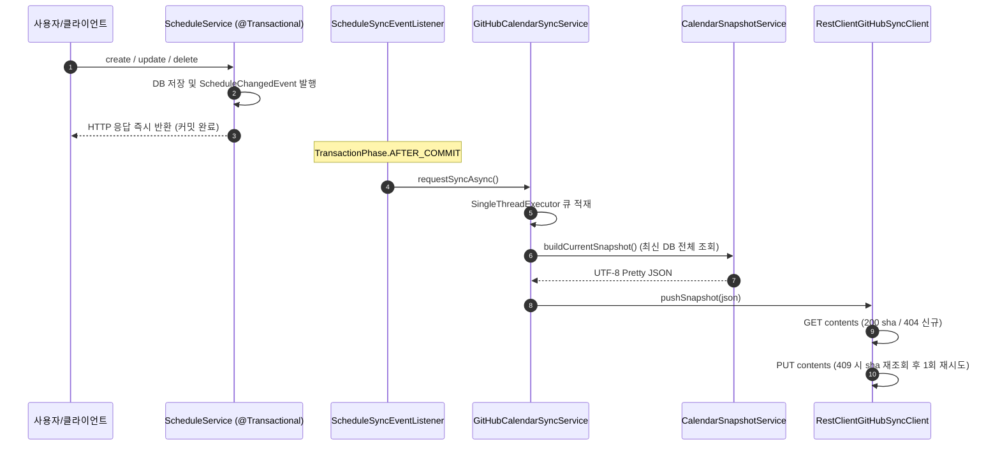

# Design Document: github-calendar-sync

> **폴더 위치**: `.kiro/specs/mycalendar/003-github-calendar-sync/design.md`
> **관련 규칙**: `rules/coding/code-style.md`, `rules/workflow/codegraph-first.md`

---

## 1. Overview (개요)

본 설계는 `mycalendar` 모듈(`com.myapps.web.mycalendar`)에 일정 변경 시 비공개 GitHub 레포지토리(`gonyda/mike`)의 `calendar/mycalendar.json`으로 전체 일정을 단방향 스냅샷 동기화하는 기능을 정의한다.

### 1.1. 핵심 설계 결정 및 트레이드오프
| 항목 / 대안 | 선택된 결정 | 근거 및 트레이드오프 | 관련 요구사항 |
|---|---|---|---|
| **트랜잭션 경계** | `ApplicationEventPublisher` + `@TransactionalEventListener(AFTER_COMMIT)` | 롤백 시 외부 푸시 차단, 커밋 후 비동기 실행으로 CUD 응답 지연 0ms | Req 1.1, 1.2 |
| **동시성 제어** | 단일 스레드 `ExecutorService` + `AtomicBoolean` 병합 플래그 | 동일 파일 덮어쓰기 시 `sha` 경합 및 순서 역전 방지, 버스트 변경 시 최신 상태만 1회 푸시 | Req 2.1 |
| **수동 API 컨트롤러 분리** | 별도 `ScheduleSyncController` (`@RestController`, `/schedules/sync/github`) | 기존 `ScheduleController` 슬라이스 테스트 영향 최소화, JSON 응답 일관성 확보 | Req 4.1 |
| **HTTP 클라이언트** | Spring `RestClient` + `SimpleClientHttpRequestFactory`(3s/5s) + `GitHubSyncClient` 인터페이스 | `MockRestServiceServer` 테스트 용이성 및 인프라/애플리케이션 계층 분리 | Req 2.5 |

---

## 2. Architecture (시스템 아키텍처 및 계층 구조)

### 2.1. DDD 4계층 패키지 구조
```
mycalendar/src/main/java/com/myapps/web/mycalendar/
├── interfaces/
│   └── api/
│       └── ScheduleSyncController.java          # POST /schedules/sync/github
├── application/
│   ├── dto/
│   │   ├── ScheduleChangedEvent.java            # 일정 변경 애플리케이션 이벤트
│   │   ├── CalendarSnapshot.java                # 출력 루트 JSON DTO
│   │   ├── CalendarSnapshotEvent.java           # 출력 개별 일정 JSON DTO
│   │   ├── GitHubSyncResult.java                # 동기화 실행 결과 DTO
│   │   └── GitHubSyncStatus.java                # SUCCESS / SKIPPED / FAILED
│   ├── exception/
│   │   └── GitHubSyncException.java             # GitHub 동기화 전용 예외
│   └── service/
│       ├── ScheduleService.java                 # CUD 시 이벤트 발행 추가
│       ├── ScheduleSyncEventListener.java       # AFTER_COMMIT 리스너
│       ├── CalendarSnapshotService.java         # DB 조회, 정렬, UTF-8 Pretty JSON 생성
│       ├── GitHubCalendarSyncService.java       # 단일 스레드 직렬화 및 Fail-safe 오케스트레이션
│       └── GitHubSyncClient.java                # GitHub 푸시 포트 인터페이스
├── domain/
│   └── repository/
│       └── ScheduleRepository.java              # findAllForSync() 정렬 조회 추가
└── infrastructure/
    ├── config/
    │   ├── GitHubSyncProperties.java            # @ConfigurationProperties(mycalendar.github-sync)
    │   └── GitHubSyncConfiguration.java         # RestClient 빈(3s/5s 타임아웃) 및 설정 활성화
    └── github/
        ├── RestClientGitHubSyncClient.java      # GitHub Contents API GET/PUT 및 409 재시도 구현
        ├── GitHubContentResponse.java           # GET 응답 sha 추출용 DTO
        └── GitHubContentUpdateRequest.java      # PUT 요청 바디 DTO
```

### 2.2. 시퀀스 다이어그램


---

## 3. Components and Interfaces

- **`GitHubSyncProperties`**: `enabled`(기본 `false`), `token`(`${MIKE_GITHUB_TOKEN:}`), `owner`(`gonyda`), `repo`(`mike`), `branch`(`main`), `path`(`calendar/mycalendar.json`), `commitMessage`(`chore(calendar): sync mycalendar events`). `toString()`에서 `token` 마스킹.
- **`ScheduleRepository.findAllForSync()`**: `ORDER BY s.startDate ASC, s.scheduleTime ASC NULLS LAST, s.id ASC`.
- **`CalendarSnapshotService`**:
  - `Asia/Seoul` 기준 `OffsetDateTime` 초 단위 절사(`ISO_OFFSET_DATE_TIME`).
  - Java Comparator 이중 정렬 보장(`startDate` ASC -> `scheduleTime` ASC nullsLast -> `id` ASC nullsLast).
  - Jackson 3 `ObjectMapper` + `DefaultPrettyPrinter`(2-space, `\n`) + UTF-8 문자열(개행 포함) 생성.
- **`RestClientGitHubSyncClient`**:
  - `UriBuilder` `pathSegment` 단위로 `path` 분할 추가하여 `/`가 `%2F`로 인코딩되지 않도록 방지.
  - `404 Not Found` 시 `sha` 없이 `PUT`, `409 Conflict` 시 `GET` 재조회 후 최대 1회 재시도.
- **`ScheduleSyncController`**: `POST /schedules/sync/github` -> `SUCCESS`/`SKIPPED` 시 `200 OK`, `FAILED` 시 `502 Bad Gateway` + `GitHubSyncResult` JSON 반환.

---

## 4. Testing Strategy

1. `RestClientGitHubSyncClientTest`: `MockRestServiceServer` 기반 `GET 200 -> PUT 200`, `GET 404 -> PUT 201`, `409 Conflict -> GET 재조회 -> PUT 200` 1회 재시도, `5xx`/네트워크 예외 시 `GitHubSyncException` 래핑, 헤더 및 Base64(개행 제거) 검증, `enabled=false` 또는 토큰 누락 시 HTTP 미호출 검증.
2. `CalendarSnapshotServiceTest`: KST `+09:00` 포맷, 정렬 순서(날짜 -> 시간 null 후순위 -> ID), 한글 UTF-8 직렬화(비이스케이프) 검증.
3. `GitHubCalendarSyncServiceTest`: 단일 스레드 직렬화, 비활성화/토큰 누락 no-op, 예외 삼킴(Fail-safe), 수동 동기화 결과 반환 검증.
4. `ScheduleSyncControllerTest`: `@WebMvcTest` 기반 `POST /schedules/sync/github` 성공/스킵(`200`) 및 실패(`502`) 응답 검증.
5. `ScheduleSyncIntegrationTest`: `@SpringBootTest` 기반 커밋 후 동기화 트리거, 유효성 실패 롤백 시 미호출, 동기화 실패가 CUD 트랜잭션에 무영향임을 검증.
