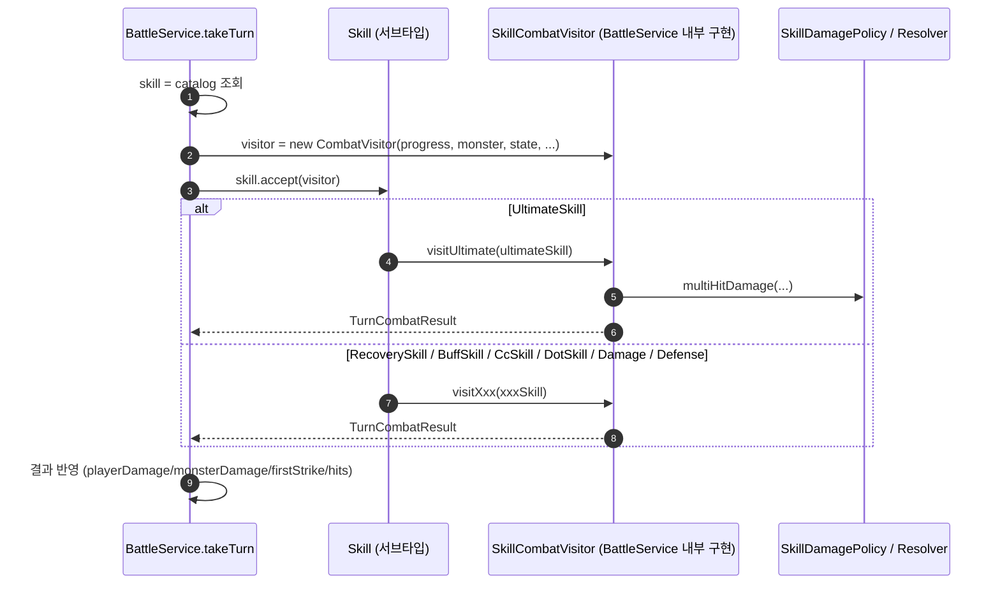
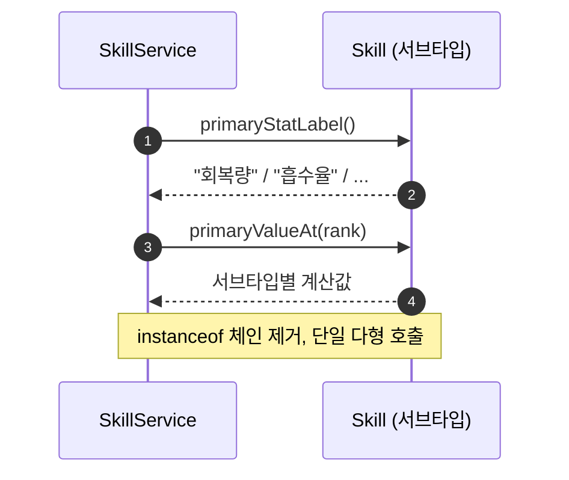

# Design Document: 스킬 타입 다형화 (Skill Type Polymorphism)

> **폴더 위치**: `.kiro/specs/myrpg/020-skill-type-polymorphism/design.md`
> **관련 규칙**: `rules/coding/code-style.md`, `rules/workflow/codegraph-first.md`

---

## 1. Overview (개요)

본 설계는 `myrpg` 모듈(`com.myapps.web.myrpg`)의 `SkillService`·`BattleService`에 산재한
스킬 서브타입 `instanceof` 분기를 **다형성 + Visitor 패턴**으로 축약하기 위한 상세 설계를 정의한다.
기능 변경이 없는 **동작 보존 리팩토링(behavior-preserving refactoring)** 이며, 게임 결과·표시·로그는
리팩토링 전후 동일해야 한다.

분기의 성격은 두 가지로 나뉘며, 각각 다른 기법을 적용한다.

- **(A) 순수 값 계산 분기** — 입력이 `Skill`(+`SkillRank`)뿐이고 외부 협력객체가 없음.
  → `Skill` 인터페이스의 **다형 메서드**로 서브타입에 위임.
- **(B) 전투 처리 분기** — `resolver`, `random`, `characterSkillRepository`,
  `gameMessageService`, `statProgression`, `skillService` 등 서비스 협력객체가 필요.
  → 순수 record로 옮길 수 없으므로 **Visitor 패턴**으로 서비스가 로직을 보유하고 타입 디스패치만 위임.

### 1.1. 핵심 설계 결정 및 트레이드오프

| 항목 / 대안 | 선택된 결정 | 근거 및 트레이드오프 | 관련 요구사항 |
|---|---|---|---|
| **값 계산 분기 처리** (인터페이스 다형 vs Visitor vs switch) | `Skill` 인터페이스 **다형 메서드** | 값 계산은 서브타입 데이터만 필요 → 각 record가 자신의 규칙 소유가 응집도 최상. Visitor는 과설계. | Req 1.1~1.5 |
| **전투 처리 분기 처리** (record 이동 vs Visitor vs sealed switch) | **Visitor 패턴** (`SkillCombatVisitor<R>` + `Skill.accept`) | 전투 로직은 서비스 협력객체 의존 → record로 이동 불가. Visitor는 sealed 대비 새 타입 추가 시 컴파일 강제(Req의 OCP 목적 부합). | Req 2.1~2.5 |
| **sealed switch 병행 여부** | 단순 2~3분기 지점은 **sealed `switch` 패턴 매칭** 허용 | Visitor 남발 방지. Java 21 exhaustive switch는 default 불필요 → 새 타입 추가 시 컴파일 에러로 누락 방지. | Req 1.5, 2.1 |
| **`SkillDamagePolicy` 위치** | 순수 도메인 정책 **유지**, 서브타입이 필요 시 위임 | 블록률/카운터 배율 계산 로직 재사용. record가 정책을 참조하거나, 서비스가 정책을 Visitor에 주입. | Req 1.3, 2.1 |
| **하위호환 API** | 기존 서브타입 메서드(`healAmountAt` 등) **유지** | 광범위한 호출부·테스트 존재. 신규 다형 메서드는 기존 메서드에 위임하여 중복 없이 추가. | Req 3.4 |
| **`Skill` sealed 유지** | `sealed` **유지** | 8종 폐쇄집합의 exhaustiveness 보장, switch 안전. | Req 3.5 |

---

## 2. Architecture (시스템 아키텍처 및 계층 구조)

### 2.1. DDD 4계층 내 변경 지점 (신규/수정)

```
myrpg/src/main/java/com/myapps/web/myrpg/
├── application/
│   └── service/
│       ├── SkillService.java              # [수정] instanceof 체인 → 다형 호출로 축약
│       └── BattleService.java             # [수정] instanceof 체인 → 다형/Visitor 디스패치로 축약
└── domain/
    ├── model/
    │   ├── Skill.java                     # [수정] 값 조회 다형 메서드 + accept(visitor) 선언
    │   ├── DamageSkill.java               # [수정] 다형 메서드 구현 (기존 메서드에 위임)
    │   ├── DefenseSkill.java              # [수정] 다형 메서드 구현
    │   ├── RecoverySkill.java             # [수정] 다형 메서드 구현
    │   ├── UltimateSkill.java             # [수정] 다형 메서드 구현
    │   ├── PassiveSkill.java              # [수정] 다형 메서드 구현
    │   ├── BuffSkill.java                 # [수정] 다형 메서드 구현
    │   ├── CcSkill.java                   # [수정] 다형 메서드 구현
    │   └── DotSkill.java                  # [수정] 다형 메서드 구현
    └── service/
        ├── SkillCombatVisitor.java        # [신규] 전투 처리 방문자 인터페이스 (제네릭 R)
        └── SkillDamagePolicy.java         # [유지] 순수 정책 (필요 시 다형 메서드가 참조)
```

> **계층 규칙(ArchUnit)**: `SkillCombatVisitor`는 `domain/service`에 위치하되, 그 **구현체는
> `BattleService` 내부(또는 application 계층)** 에 두어 서비스 협력객체(리포지토리/랜덤/메시지)를
> 캡처한다. 인터페이스 자체는 상위 계층을 참조하지 않는다. `TurnCombatResult` 등 서비스 내부 타입을
> Visitor 시그니처에 노출하지 않도록, 방문자의 반환 타입 `R`은 서비스 측에서 바인딩한다.

### 2.2. Visitor 디스패치 시퀀스 (전투 턴)



### 2.3. 값 다형 호출 흐름 (스킬 표시/스탯)



---

## 3. Components and Interfaces (세부 컴포넌트 설계)

### 3.1. Domain Layer — `Skill` 다형 계약 확장 (`domain/model/Skill.java`)

`Skill` 인터페이스에 아래 값 조회 다형 메서드와 Visitor accept를 추가한다. 기본 스탯이 없는
서브타입을 위해 합리적 default를 제공하여 각 record의 구현 부담을 최소화한다.

```java
public sealed interface Skill permits DamageSkill, DefenseSkill, RecoverySkill,
        UltimateSkill, PassiveSkill, BuffSkill, CcSkill, DotSkill {

    // ... 기존 메서드 (id, label, type, talent, resourceCost, description,
    //     effectRowsAt, rankupBonusDelta, isPassive) 유지 ...

    /**
     * 스킬 표시용 기본 스탯 라벨을 반환한다 (예: "회복량", "흡수율").
     *
     * @return 기본 스탯 라벨
     */
    String primaryStatLabel();

    /**
     * 지정 랭크에서의 기본 대표값을 반환한다 (배율/블록률/회복량/성공률 등).
     *
     * @param rank 스킬 랭크
     * @return 대표값 (정의 없으면 0)
     */
    int primaryValueAt(SkillRank rank);

    /**
     * 지정 랭크에서의 자원 소모량을 반환한다. 기본은 랭크 무관 고정값.
     *
     * @param rank 스킬 랭크
     * @return 자원 소모량
     */
    default int resourceCostAt(final SkillRank rank) {
        return resourceCost();
    }

    /**
     * 지정 랭크에서의 카운터 값을 반환한다. 카운터가 없으면 빈 값.
     *
     * @param rank 스킬 랭크
     * @return 카운터 배율 Optional
     */
    default Optional<Integer> counterValueAt(final SkillRank rank) {
        return Optional.empty();
    }

    /**
     * 지정 랭크에서의 크리티컬 보너스 값을 반환한다. 없으면 빈 값.
     *
     * @param rank 스킬 랭크
     * @return 크리 보너스 Optional
     */
    default Optional<Integer> critBonusValueAt(final SkillRank rank) {
        return Optional.empty();
    }

    /**
     * 전투 처리 방문자를 수락하여 서브타입별 처리로 디스패치한다.
     *
     * @param visitor 전투 방문자
     * @param <R> 방문 결과 타입
     * @return 방문 결과
     */
    <R> R accept(SkillCombatVisitor<R> visitor);
}
```

- **서브타입별 구현 매핑** (기존 메서드에 위임, 중복 로직 생성 금지):

  > **주의(동작 보존)**: 아래 라벨 문자열·값은 리팩토링 이전 `SkillService`의 실제 반환과
  > **바이트 단위로 동일**해야 한다. 특히 기존 `primaryStatLabel`의 default fall-through(=`DamageSkill`,
  > `UltimateSkill`)는 `PRIMARY_STAT_DAMAGE`("보너스 데미지")를 반환하므로, 다형화 시 두 서브타입 모두
  > 동일 문자열을 반환해야 한다.

  | 서브타입 | `primaryStatLabel()` | `primaryValueAt(rank)` | `resourceCostAt(rank)` | `counterValueAt` | `critBonusValueAt` |
  |---|---|---|---|---|---|
  | DamageSkill | "보너스 데미지" | `SkillDamagePolicy.multiplier(this, rank)` (누락 시 예외 보존) | 기본(고정) | empty | empty |
  | DefenseSkill | "피해 경감" | `SkillDamagePolicy.blockRate(this, rank)` | `resourceCostAt(rank)` | `counterMultiplier`>0 시 값 | `critBonusByRank` 비어있지 않으면 `critBonusAt(rank)` |
  | RecoverySkill | "회복량" | `healAmountAt(rank)` | `resourceCostAt(rank)` | empty | empty |
  | UltimateSkill | "보너스 데미지" | `multiplierAt(rank)` | 기본 | empty | empty |
  | BuffSkill | "흡수율" | `absorbRateAt(rank)` | 기본 | empty | empty |
  | CcSkill | "성공률" | `successRateAt(rank)` | 기본 | empty | empty |
  | DotSkill | "초기 배율" | `initialMultiplierAt(rank)` | 기본 | empty | empty |
  | PassiveSkill | "패시브 효과" | 0 | 기본 | empty | empty |

  > `multiplier`/`blockRate`/`counterMultiplier`는 `SkillDamagePolicy` 순수 계산에 의존하며, **누락 랭크
  > 키에 대해 `IllegalArgumentException`을 던지는 기존 동작을 보존**해야 한다(0으로 폴백 금지).
  > 따라서 `DamageSkill.primaryValueAt`는 `multiplierByRank.get(rank)` 직접 조회가 아니라
  > **동일한 정책 계산식(`SkillDamagePolicy.multiplier`)에 위임**한다. DefenseSkill의 다형 구현도 정책
  > 계산식을 호출한다(정책을 도메인 순수 유틸로 유지하고 record가 위임 호출).
  >
  > `counterValueAt`/`critBonusValueAt`는 내부적으로 `Optional<Integer>`를 반환하지만, `SkillService`
  > 호출부에서 `.orElse(null)`로 되돌려 **기존 `Integer null` 반환값을 그대로 보존**한다.

### 3.2. Domain Layer — `SkillCombatVisitor` (신규, `domain/service/SkillCombatVisitor.java`)

```java
/**
 * 스킬 서브타입별 전투 처리를 위임받는 방문자 인터페이스.
 *
 * <p>서비스 협력객체(랜덤/리포지토리/메시지 등)를 캡처한 구현체가 각 서브타입에 대응하는
 * 전투 처리를 수행한다. sealed {@link Skill}의 8종 서브타입을 모두 방문한다.
 *
 * @param <R> 방문 결과 타입 (서비스 측에서 바인딩)
 */
public interface SkillCombatVisitor<R> {
    R visitDamage(DamageSkill skill);
    R visitDefense(DefenseSkill skill);
    R visitRecovery(RecoverySkill skill);
    R visitUltimate(UltimateSkill skill);
    R visitPassive(PassiveSkill skill);
    R visitBuff(BuffSkill skill);
    R visitCc(CcSkill skill);
    R visitDot(DotSkill skill);
}
```

- 각 서브타입 record는 `accept`를 구현: 예) `UltimateSkill` → `return visitor.visitUltimate(this);`

### 3.3. Application Layer — `BattleService` 리팩토링

- **전투 디스패치**(`takeTurn` 내 `instanceof` if/else 사슬):
  서비스 협력객체를 캡처하는 내부 클래스 `CombatDispatchVisitor implements SkillCombatVisitor<TurnCombatResult>`를
  두고, `skill.accept(visitor)`로 전환. 각 `visitXxx`가 기존 `resolveXxxCombat` private 메서드를 호출.
- **스탯 해석**(`resolvePlayerMultiplier`/`resolvePlayerBlockRate`/`resolvePlayerCounterPercent`/
  `resolveResourceCost`/`resolveEffectivePlayerCritical`/`resolvePlayerHitCount`):
  이들은 **`SkillService`의 값 메서드와 매핑·fallback이 다르므로 `primaryValueAt` 등을 재사용하지 않는다.**
  각 메서드의 **처리 타입 부분집합과 fallback을 아래 표대로 100% 보존**하고, `instanceof` 타입 판별만
  sealed switch(또는 전용 Visitor)로 대체한다. 미보유/폴백 방어 분기는 서비스에 유지(도메인 순수성 보존).

  | 해석 메서드 | 값 반환 타입 | 그 외 타입 fallback | 스킬 미보유 시 |
  |---|---|---|---|
  | `resolvePlayerMultiplier` | Damage→배율, Dot→초기배율 | `monsterNormalMultiplier()` | `monsterNormalMultiplier()` |
  | `resolvePlayerBlockRate` | Defense→블록률 | 0 | 0 |
  | `resolvePlayerCounterPercent` | Defense→카운터 배율 | 0 | 0 |
  | `resolvePlayerHitCount` | Damage→`hitCount()` | 1 | (해당 없음) |
  | `resolveEffectivePlayerCritical` | Damage→`critBonus()`, Defense→`critBonusAt(rank)` | +0 | Defense는 보너스 0 |
  | `resolveResourceCost` | Defense/Recovery→랭크별 소모 | `resourceCost()` 고정 | `resourceCost()` |

  > `UltimateSkill`의 실효 크리티컬은 `resolveEffectivePlayerCritical`가 0을 더한 뒤 궁극기 전투 핸들러에서
  > `+ ultimateSkill.critBonus()`가 가산되는 기존 2단계 합산을 그대로 유지한다.
- 기존 `resolveXxxCombat` 메서드 시그니처·본문은 최대한 보존하고 **호출 경로만 Visitor로** 바꾼다.
  `takeTurn`의 명시 분기는 `UltimateSkill`/`RecoverySkill`/`BuffSkill`/`CcSkill` 4종이며, `DotSkill`은
  `applySpecialSkillSideEffects` 경로, `DamageSkill`/`DefenseSkill`은 일반 경로임을 유지한다.

### 3.4. Application Layer — `SkillService` 리팩토링

- `primaryStatLabel(Skill)` → `catalog.primaryStatLabel()`
- `primaryValue(Skill, rank)` → `catalog.primaryValueAt(rank)`
- `resourceCost(Skill, rank)` → `catalog.resourceCostAt(rank)`
- `counterValue(Skill, rank)` → `catalog.counterValueAt(rank).orElse(null)`
- `critBonusValue(Skill, rank)` → `catalog.critBonusValueAt(rank).orElse(null)`
- `calculateRankable`의 `instanceof PassiveSkill` → `catalog.isPassive()` 활용(기존 default 사용).

### 3.5. Presentation Layer

- 변경 없음. 스킬 목록/승급 뷰 및 전투 로그의 출력 문자열·값은 리팩토링 전후 동일.

### 3.6. Error Handling (예외 처리 설계)

| 예외 상황 | 처리 주체 | 응답/폴백 | 관련 요구사항 |
|---|---|---|---|
| 미보유 스킬 (`CharacterSkill` 없음) | BattleService | 기존과 동일 폴백(기본 배율/0/차단) 유지 | Req 2.4, 3.3 |
| 궁극기 쿨타임 잔존 | BattleService | 기존과 동일 사용 차단 분기 유지 | Req 2.4 |
| 카운터/크리 미정의 서브타입 | 서브타입 다형 메서드 | `Optional.empty()` → 호출부 `null`/0 폴백 | Req 1.4 |
| 미지 스킬 식별자 | SkillCatalogService | 기존과 동일 빈 Optional 폴백 | Req 3.3 |

---

## 4. Data Models (데이터 모델)

- **신규 엔티티/JSON 카탈로그 없음.** 본 스펙은 순수 리팩토링으로 영속 스키마·JSON 데이터·DTO 필드
  변경이 없다. `record` 서브타입의 필드 구성도 불변이며, 다형 **메서드**만 추가한다.
- **불변성 유지**: 모든 서브타입은 `record`로 불변을 유지하고, 추가 메서드는 부수효과 없는 순수 계산이다.

---

## 5. Correctness Properties (jqwik 검증용 불변 속성 명세)

### Property 1: 값 다형 메서드 == 기존 instanceof 결과 (동치성)
*For any* 8종 서브타입의 임의 인스턴스와 임의 `SkillRank`에 대해,
`skill.primaryStatLabel()`, `skill.primaryValueAt(rank)`, `skill.resourceCostAt(rank)`,
`skill.counterValueAt(rank)`, `skill.critBonusValueAt(rank)`의 결과는
리팩토링 이전 `SkillService`의 instanceof 분기가 산출하던 값과 **정확히 동일**해야 한다.
- **Validates: Requirements 1.2, 1.3, 1.4, 3.1**

### Property 2: Visitor exhaustiveness & 디스패치 정합성
*For any* 8종 서브타입에 대해, `skill.accept(visitor)`는 항상 해당 서브타입에 대응하는
`visitXxx`를 정확히 1회 호출해야 하며(오디스패치 없음), 미구현·누락 방문 메서드가 없어야 한다.
- **Validates: Requirements 2.2, 2.5, 3.5**

### Property 3: 전투 결과 동작 보존
*For any* 유효한 전투 입력(캐릭터/몬스터/스킬/랭크/시드 고정 `Random`)에 대해,
Visitor 기반 전투 처리 결과(`TurnCombatResult`의 데미지/회복/상태효과/로그)는
리팩토링 이전 `instanceof` 디스패치 결과와 동일해야 한다.
- **Validates: Requirements 2.2, 3.2**

### Property 4: 폴백 불변식
*For any* 미보유/미지 스킬 입력에 대해, 시스템은 예외를 던지거나 리팩토링 이전과 동일한
안전 기본값으로 폴백하며 데이터 손상이 없어야 한다.
- **Validates: Requirements 2.4, 3.3**

---

## 6. Testing Strategy & Quality Guardrails (테스트 및 품질 검증 전략)

### 6.1. 테스트 계층
1. **단위 테스트**: 각 서브타입 다형 메서드가 기존 계산값과 일치하는지(테이블 기반) 검증.
2. **PBT (jqwik)**: Property 1~4 (동치성/디스패치 정합성/동작 보존/폴백) 검증.
3. **회귀 테스트(기존)**: `BattleService*Test`, `SkillCatalog*Test`, 전투 프로퍼티 테스트 전수 통과.
4. **웹 슬라이스(기존)**: 스킬/전투 컨트롤러 슬라이스 테스트 그린 유지.

### 6.2. 테스트 작성 규칙 (`rules/coding/code-style.md`)
- Given-When-Then 3단계 주석, `should_{동작}_when_{조건}` 네이밍.
- Spring Boot 4.0: `@MockitoBean`, `@WebMvcTest`/`@DataJpaTest` 신규 패키지, Jackson 3 `tools.jackson`.
- jqwik + Mock: `Mockito.mock()` 직접 호출.
- **리팩토링 안전망**: 변경 전 기존 테스트가 전부 그린임을 먼저 확인하고, 변경 후에도 동일하게 그린 유지.

### 6.3. 5대 품질 가드레일 실행 명령어
```bash
mvn -B -q spotless:apply -pl myrpg && (mvn -B clean install -pl myrpg -am > /tmp/mvn.log 2>&1 || (tail -n 30 /tmp/mvn.log && exit 1)) && tail -n 12 /tmp/mvn.log && codegraph sync
```

> **PMD/CPD 기대 효과**: 본 리팩토링은 `SkillService`/`BattleService`의 `CognitiveComplexity`와
> instanceof 중복(CPD)을 **감소**시켜야 하며, 신규 Visitor/다형 메서드는 단순 위임으로 복잡도를
> 새로 유발하지 않아야 한다.
