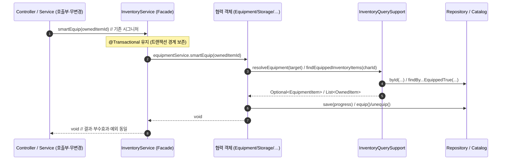
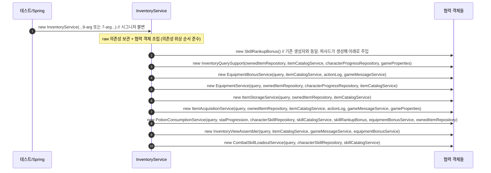

# Design Document: InventoryService God Class 분해 (Inventory Service Decomposition)

> **폴더 위치**: `.kiro/specs/myrpg/021-inventory-service-decomposition/design.md`
> **관련 규칙**: `rules/coding/code-style.md`, `rules/workflow/codegraph-first.md`

---

## 1. Overview (개요)

본 설계는 `myrpg` 모듈(`com.myapps.web.myrpg`)의 God Class `InventoryService`(약 1,708줄, 의존성 10개)를
**동작 보존(behavior-preserving) 리팩토링**으로 분해하기 위한 상세 설계를 정의한다. 기능 변경은 없으며,
게임 결과·표시·로그·예외·트랜잭션 경계는 리팩토링 전후 완전히 동일해야 한다.

분해 전략의 핵심은 두 축이다.

- **(A) 파사드 + 위임(Facade + Delegation)** — `InventoryService`는 기존 public API와 두 생성자를 그대로
  유지하는 **얇은 파사드**로 남고, 실제 처리는 관심사별 협력 객체로 위임한다. 외부 호출부(컨트롤러/서비스)와
  20여 개 테스트가 한 줄도 바뀌지 않는다.
- **(B) 공유 지원 컴포넌트로 중복 통합(DRY)** — 여러 메서드에 흩어진 카탈로그→장비 판별, 장착 아이템/슬롯
  조회, 캐릭터 폴백 조회, 용량 산정, 무기 세트 처리를 `InventoryQuerySupport` 한 곳으로 모은다.

### 1.1. 핵심 설계 결정 및 트레이드오프

| 항목 / 대안 | 선택된 결정 | 근거 및 트레이드오프 | 관련 요구사항 |
|---|---|---|---|
| **분해 방식** (in-place 정리 vs 파사드+협력객체 vs 완전 대체) | **파사드 + 협력 객체 추출(Extract Class)** | 파사드가 기존 계약을 100% 보존 → 호출부/테스트 무변경. 완전 대체는 회귀 위험 과대. | Req 1, 2 |
| **협력 객체를 Spring 빈으로 등록 vs 파사드 소유 plain 객체** | **파사드가 소유·구성하는 plain 객체** | 협력 객체를 빈으로 만들면 `InventoryService` 생성자에 주입해야 하고, 이는 **7-arg 하위호환 생성자로 직접 생성하는 20여 개 테스트**와 Spring 주입부를 모두 깨뜨림. plain 객체로 두면 두 생성자에서 raw 의존성으로 협력 객체를 조립할 수 있어 계약이 불변. (기존 `SkillRankupBonus`를 `new`로 생성하던 패턴과 동일.) | Req 1.1, 1.2, 4.6 |
| **트랜잭션 경계** | **`@Transactional`을 파사드 메서드에 유지** | 협력 객체가 빈이 아니므로 그 위의 `@Transactional`은 프록시가 없어 무효. 파사드 진입점에서 트랜잭션이 시작되던 기존 동작을 그대로 보존. `smartEquip`이 내부적으로 `equip`을 호출하던 것은 원래도 **자기호출(self-invocation)이라 내부 `@Transactional`이 no-op**였고, 리팩토링 후 `EquipmentService.smartEquip → EquipmentService.equip`도 파사드의 단일 트랜잭션 안에서 실행되어 동작이 동일하다. | Req 1.3 |
| **테스트 리플렉션 안전성** | 파사드 내부 필드 재구성 허용 | 기존 테스트의 리플렉션은 `InventoryService`가 아니라 **`OwnedItem`의 `id` 필드만** 대상(확인함)이므로, 파사드의 private 필드를 협력 객체로 교체해도 테스트가 깨지지 않는다. | Req 1.2, 4.6 |
| **중복 통합 지점** | `InventoryQuerySupport` 단일 지원 컴포넌트 | 카탈로그→장비 해석/장착조회/슬롯맵/캐릭터폴백/용량산정을 한 곳으로 → CPD·복잡도 감소, 신규 기능 재사용. | Req 3.1~3.4 |
| **판별 방식(`instanceof`) 변경 범위** | **위치만 이동, 판별식은 원형 유지** | 아이템 다형화는 out-of-scope. 동작 보존을 위해 `instanceof`/조회 순서/폴백을 그대로 옮긴다. | Req 1.4, 3.5 |
| **뷰 조립 위치** | `InventoryViewAssembler`(application) | 뷰 DTO 조립은 표현 조립 관심사. `interfaces`가 아닌 `application`에 두어 파사드가 위임(기존 위치 유지, ArchUnit 안전). | Req 2.3 |
| **기존 오버로드/기본 캐릭터(1L) 폴백** | 전량 보존 | `characterId != null ? characterId : 1L`, `equippedBonus()` vs `equippedBonus(Long)` 등 폴백·오버로드를 협력 객체로 그대로 이전. | Req 3.5, 4.* |

> **왜 빈이 아니라 plain 협력 객체인가 (가장 중요한 결정)**: 테스트 20여 개가
> `new InventoryService(ownedItemRepository, itemCatalogService, characterProgressRepository,
> statProgression, actionLog, skillCatalogService, characterSkillRepository)` 형태의 **7-arg 생성자**로
> 실제 인스턴스를 만든다. 협력 객체를 생성자 주입 빈으로 바꾸면 이 20여 개 파일과 Spring 주입부가 전부
> 바뀌어 "1%도 안 바뀜" 제약을 위반한다. 따라서 협력 객체는 파사드의 두 생성자 내부에서 raw 의존성으로
> 조립되는 plain 객체로 둔다. (원한다면 후속 스펙에서 빈 전환 가능하나 본 스펙 범위 밖.)

---

## 2. Architecture (시스템 아키텍처 및 계층 구조)

### 2.1. DDD 4계층 내 변경 지점 (신규/수정)

```
myrpg/src/main/java/com/myapps/web/myrpg/
├── application/
│   └── service/
│       ├── InventoryService.java              # [수정] 파사드로 축소, 협력 객체 조립 + 위임
│       ├── inventory/                          # [신규 패키지] 인벤토리 협력 객체 모음
│       │   ├── InventoryQuerySupport.java      # [신규] 공유 조회/판별/용량 지원 (중복 통합 단일 지점)
│       │   ├── EquipmentService.java           # [신규] 착용/해제/스마트/스왑/후보/무기재능
│       │   ├── ItemStorageService.java         # [신규] 은행↔인벤 이동 + 용량 검사/스택 이동
│       │   ├── ItemAcquisitionService.java     # [신규] 드랍/구매 획득 + 기본 시딩
│       │   ├── PotionConsumptionService.java   # [신규] 포션 사용(HP/MP/Stamina 회복)
│       │   ├── EquipmentBonusService.java      # [신규] 장착 보너스 합산 + 내구도 감소/자동해제
│       │   ├── InventoryViewAssembler.java     # [신규] 인벤/은행/장비 뷰 + describe + 포맷
│       │   └── CombatSkillLoadoutService.java  # [신규] 전투 스킬 버튼 10슬롯 구성
│       ├── ItemCatalogService.java             # [유지]
│       └── SkillCatalogService.java            # [유지]
└── domain/
    └── model/ ...                              # [유지] 엔티티/DTO/enum 변경 없음
```

> **협력 객체 배치 근거(ArchUnit)**: 모든 협력 객체는 `application/service/inventory` 하위(=application
> 계층)에 위치하여 `interfaces`(상위)를 참조하지 않는다. 협력 객체는 서로 및 `InventoryQuerySupport`,
> `ItemCatalogService`, 도메인 리포지토리를 참조할 수 있다. 참조 방향은 파사드 → 협력 객체 →
> `InventoryQuerySupport` 단방향으로 유지하여 순환을 만들지 않는다.

### 2.2. 파사드 구성 및 위임 시퀀스



### 2.3. 생성자 조립 흐름 (계약 보존)



> **조립 순서(위상 정렬) 주의**: `EquipmentBonusService`는 `PotionConsumptionService`와
> `InventoryViewAssembler`가 의존하므로 **반드시 그 둘보다 먼저 생성**되어야 한다. 위 시퀀스는
> `SkillRankupBonus` → `InventoryQuerySupport` → `EquipmentBonusService` → 나머지 순의 의존성 위상
> 순서를 따른다.
> **`SkillRankupBonus` 생성 주체**: 기존 생성자가 `new SkillRankupBonus()`로 직접 생성하던 것과 동일하게,
> **파사드가 생성**하여 `PotionConsumptionService`에 주입한다(협력 객체가 스스로 `new` 하지 않는다).
> 협력 객체는 두 생성자 모두에서 동일하게 조립되며, 7-arg 하위호환 생성자는 기존처럼
> `GameMessageService`/`GameProperties`를 기본값으로 채운 뒤 동일 조립 경로를 탄다.

---

## 3. Components and Interfaces (세부 컴포넌트 설계)

### 3.1. 책임 → 협력 객체 매핑표

아래는 기존 `InventoryService`의 public/ private 멤버를 협력 객체로 배정한 결과다. **파사드는 각 public
메서드를 대응 협력 객체 호출로 위임**한다(로직은 이동만, 내용 불변).

| 협력 객체 | 위임받는 파사드 public 메서드 | 이관되는 private helper | 필요 협력자 |
|---|---|---|---|
| **InventoryQuerySupport** | (없음, 내부 지원 전용) | `findOwnedItemOrThrow`, `resolveEquipmentItem`, `resolveEquipment(→Optional)`, `findEquippedInventoryItems`, `resolveEquippedSlotMap`, `findCharacterSafe`, `loadCharacter`, `resolveOtherSetAssignedItemIds`, `countStorage`, `checkCapacity`, `hasCapacity`, `isInventoryFull`, `maxCapacity`, `resolveMaxDurability`, `findStorageItem` | ownedItemRepository, itemCatalogService, characterProgressRepository, gameProperties |
| **EquipmentService** | `equip`, `unequip`, `smartEquip`, `swapWeapon`, `findEquippableForSlot`, `equippedWeaponTalent`(+Long), `isBowEquipped`(+Long) | `findSlotOccupier`, `unequipSamePrimarySlot`, `autoUnequipShieldForTwoHanded`, `autoUnequipTwoHandedForShield`, `clearFromOtherWeaponSet`, `resolveProgressForSwap`, `syncCurrentWeaponSetSlots`, `resolveExistingOwnedId`, `unequipWeaponSlots`, `equipTargetWeaponSet`, `resolveEquippedWeaponTalent`, `mapKindToSkillTalent` | query, ownedItemRepository, characterProgressRepository, itemCatalogService |
| **ItemStorageService** | `moveToBank`, `moveToInventory` | `movePotionToStorage` | query, ownedItemRepository, itemCatalogService |
| **ItemAcquisitionService** | `acquire`, `acquireItem`(+오버로드), `seedDefault`(+오버로드) | `acquireSingleItem`, `acquirePotion`, `acquireEquipment`, `acquirePotionItem`, `seedEquipment`, `defaultPotionQuantity`, `logItemAcquireFailure` | query, ownedItemRepository, itemCatalogService, actionLog, gameMessageService, gameProperties |
| **PotionConsumptionService** | `usePotion` | (VITAL 최대치 산정 로직) | query, statProgression, characterSkillRepository, skillCatalogService, skillRankupBonus, equipmentBonusService, ownedItemRepository |
| **EquipmentBonusService** | `equippedBonus`(+Long), `reduceDurabilityAndAutoUnequip` | `applyStatDelta`, `applyVitalDelta`, `autoUnequipBroken` | query, itemCatalogService, actionLog, gameMessageService |
| **InventoryViewAssembler** | `buildInventoryView`(+오버로드), `buildBankView`(+오버로드), `buildEquipmentView`(+오버로드), `describe` | `toOwnedItemView`, `isMainHandTwoHanded`, `assembleEquipmentSlots`, `calculateAverageDurability`, `resolveWeaponTalentLabel`, `toSlotView`, `formatBonusesSummary`, `appendEquipmentDescription`, `buildDurabilityText`, `formatBonus`, `bonusTargetLabel`, `formatDurability` | query(무기재능 라벨은 `query.resolveEquippedWeaponTalent`), itemCatalogService, gameMessageService, equipmentBonusService |
| **CombatSkillLoadoutService** | `combatSkills` | `resolveOwnedSkills`, `buildSlotButton`, `resolveSkillIcon` | query(무기재능은 `query.resolveEquippedWeaponTalent`), characterSkillRepository, skillCatalogService |

> **협력자 간 의존 주의(순환 방지)**: `InventoryViewAssembler`·`CombatSkillLoadoutService`가 착용 무기
> 재능을 위해 `EquipmentService.resolveEquippedWeaponTalent`가 필요하다. 순환을 피하기 위해 **무기 재능
> 해석(`resolveEquippedWeaponTalent`/`mapKindToSkillTalent`)은 `InventoryQuerySupport`로 이관**하고,
> `EquipmentService`의 public `equippedWeaponTalent`/`isBowEquipped`는 query 위임으로 구현한다. 이렇게
> 하면 모든 협력 객체가 query만 바라보는 단방향 그래프가 되어 순환이 없다.
> (매핑표의 `resolveEquippedWeaponTalent`/`mapKindToSkillTalent`는 최종적으로 QuerySupport 소속으로 확정.)
>
> **`describe` 다중 호출부 보존**: `describe(Item, OwnedItem)`는 파사드 외에 `ShopService`,
> `RepairController`도 파사드를 통해 호출한다. 구현을 `InventoryViewAssembler`로 이관하더라도 파사드의
> `describe`가 위임으로 남으므로 두 호출부는 무변경으로 동일 결과를 얻는다.

### 3.2. `InventoryQuerySupport` (신규, 중복 통합 단일 지점)

가장 반복이 심한 두 패턴을 통합한다.

```java
/**
 * 인벤토리 협력 객체들이 공통으로 사용하는 조회/판별/용량 지원 컴포넌트.
 *
 * <p>카탈로그→장비 해석, 장착 아이템/슬롯 맵 조회, 캐릭터 폴백 조회, 저장소 용량 산정 등
 * 여러 곳에 중복되던 읽기 로직을 단일 지점으로 통합한다. 부수효과 없는 순수 조회만 담당한다.
 */
final class InventoryQuerySupport {
    // 중복 블록 통합의 핵심: catalog.byId → EquipmentItem 좁히기
    Optional<EquipmentItem> resolveEquipment(final OwnedItem owned) { ... }
    EquipmentItem resolveEquipmentOrThrow(final OwnedItem owned) { ... }

    OwnedItem findOwnedItemOrThrow(final long ownedItemId) { ... }
    List<OwnedItem> findEquippedInventoryItems(final Long characterId) { ... }
    Map<EquipSlot, OwnedItem> resolveEquippedSlotMap(final List<OwnedItem> equippedItems) { ... }
    Set<Long> resolveOtherSetAssignedItemIds(final Long characterId) { ... }

    CharacterProgress findCharacterSafe(final Long characterId) { ... }
    CharacterProgress loadCharacter(final Long characterId) { ... }

    long countStorage(final Long characterId, final StorageKind storage) { ... }
    void checkCapacity(final Long characterId, final StorageKind storage) { ... }
    boolean isInventoryFull(final Long characterId) { ... }
    int maxCapacity() { ... }
    int resolveMaxDurability(final String itemId) { ... }

    SkillTalent resolveEquippedWeaponTalent(final Long characterId) { ... }

    // characterId → 기본 캐릭터(1L) 정규화: 획득/시딩/이동 등 여러 곳에 반복되던
    // `characterId != null ? characterId : 1L` 패턴을 단일 헬퍼로 통합 (Req 3.2, 3.5)
    Long normalizeCharacterId(final Long characterId) { return characterId != null ? characterId : 1L; }
}
```

- **동작 보존 주의**: 각 메서드는 기존 본문을 **그대로** 옮긴다. 특히 `characterId != null ? ... : 1L`
  기본 캐릭터 폴백, `findByCharacterId...`가 `null` 반환 시 전체 조회로 폴백하는 순서, `Optional` vs
  `null` 반환 컨벤션을 원형 유지한다.
- **`normalizeCharacterId` 통합**: `acquireItem`/`acquirePotion`/`acquireEquipment`/`seedDefault`/
  `movePotionToStorage` 등에 산재한 `characterId != null ? characterId : 1L` 표현을 이 단일 헬퍼로 치환하여
  중복을 제거한다(결과값은 기존과 동일). 치환은 값 동치이므로 동작을 바꾸지 않는다.

### 3.3. 파사드(`InventoryService`) 형태

```java
@Service
public class InventoryService {

    private final EquipmentService equipmentService;
    private final ItemStorageService itemStorageService;
    private final ItemAcquisitionService itemAcquisitionService;
    private final PotionConsumptionService potionConsumptionService;
    private final EquipmentBonusService equipmentBonusService;
    private final InventoryViewAssembler inventoryViewAssembler;
    private final CombatSkillLoadoutService combatSkillLoadoutService;

    public InventoryService(/* 9-arg: 기존과 동일 */) { /* raw 의존성으로 협력 객체 조립 */ }

    public InventoryService(/* 7-arg: 기존 하위호환과 동일 */) {
        this(/* 기본 GameMessageService/GameProperties 채워 9-arg 위임 */);
    }

    @Transactional
    public void smartEquip(final long ownedItemId) {
        equipmentService.smartEquip(ownedItemId);   // 위임만
    }
    // ... 나머지 public 메서드도 동일하게 대응 협력 객체로 위임 ...
}
```

- 파사드 메서드는 **위임 한 줄**이 원칙이며, `@Transactional` 등 어노테이션은 기존과 동일하게 부착한다.
- 상수(`SEED_*_ID`, `LOG_TYPE_ITEM` 등)는 사용 협력 객체로 이동한다(시딩 상수는 `ItemAcquisitionService`).

### 3.4. Presentation Layer / 호출부

- **변경 없음.** `InventoryController`, `EquipmentController`, `BankController`, `RepairController`,
  `ShopService`, `DungeonService`, `GatheringService`, `BattleService`, `AuthService`,
  `CharacterService`, `PlayScreenViewHelper`, `HealController`는 파사드 API를 그대로 호출한다.

### 3.5. Error Handling (예외 처리 설계)

| 예외 상황 | 처리 주체(이관 후) | 응답/폴백 | 관련 요구사항 |
|---|---|---|---|
| 보유 아이템 미존재 | InventoryQuerySupport | 기존과 동일 `IllegalStateException("보유 아이템을 찾을 수 없습니다: …")` | Req 1.4 |
| 카탈로그 미존재 | InventoryQuerySupport | 기존과 동일 `IllegalStateException("카탈로그에 아이템이 없습니다: …")` | Req 1.4 |
| 장비 아님 | InventoryQuerySupport | 기존과 동일 `IllegalStateException("장비가 아닌 아이템입니다: …")` | Req 1.4 |
| 포션 아님 | PotionConsumptionService | 기존과 동일 `IllegalStateException("포션이 아닌 아이템은…")` | Req 1.4 |
| 착용 슬롯 충돌 | EquipmentService | 기존과 동일 `EquipConflictException("착용 할 수 없습니다.")` | Req 4.1 |
| 장착/타세트 아이템 맡기기 | ItemStorageService | 기존과 동일 `EquipConflictException("장착을 해제한 후 맡길 수 있습니다.")` | Req 4.2 |
| 용량 초과(이동) | InventoryQuerySupport(checkCapacity) | 기존과 동일 `InventoryFullException` 메시지 | Req 4.2 |
| 용량 초과(획득) | ItemAcquisitionService | 기존과 동일: 소실 + `log.item.acquire_fail` 로그 | Req 4.2 |

---

## 4. Data Models (데이터 모델)

- **신규 엔티티/DTO/JSON 카탈로그 없음.** 본 스펙은 순수 구조 리팩토링으로 영속 스키마·JSON 데이터·DTO
  필드가 변경되지 않는다. 협력 객체는 모두 무상태(stateful 필드는 주입된 협력자 참조뿐)로 두어 스레드
  안전성과 기존 동작을 유지한다.
- **불변성 유지**: 협력 객체 필드는 `final`, 조회 지원 메서드는 부수효과 없는 순수 함수로 유지한다.

---

## 5. Correctness Properties (jqwik 검증용 불변 속성 명세)

### Property 1: 파사드 위임 동치성 (공개 계약 보존)
*For any* 유효한 입력에 대해, 리팩토링 후 `InventoryService`의 각 public 메서드 결과(반환값/부수효과/
저장 호출/예외)는 리팩토링 이전과 동일해야 한다. (기존 회귀·프로퍼티 테스트가 무수정 통과로 검증)
- **Validates: Requirements 1.1, 1.4, 4.1~4.6**

### Property 2: 장착 규칙 불변식
*For any* 임의의 장비 조합/착용 상태에 대해, `equip`/`smartEquip`/`unequip`/`swapWeapon`의 결과 슬롯
점유·무기 세트 배정·자동 해제는 리팩토링 이전과 동일해야 한다.
- **Validates: Requirements 4.1** (기존 `EquipConflictPropertyTest`, `EquipSlotUniquenessPropertyTest`,
  `MultiCharacterEquipmentIsolationTest`)

### Property 3: 보관/획득/용량 불변식
*For any* 임의의 이동·획득 시퀀스와 저장소 상태에 대해, 스택 누적/개별 저장/용량 초과 거부(또는 소실+로그)
동작은 리팩토링 이전과 동일해야 한다.
- **Validates: Requirements 4.2** (기존 `ItemMovePropertyTest`, `ItemStackPropertyTest`,
  `InventoryCapacityPropertyTest`, `InventoryAcquirePropertyTest`, `MaterialStackPropertyTest`,
  `SeedDefaultItemsPropertyTest`)

### Property 4: 보너스/포션/내구도/뷰 불변식
*For any* 임의의 장착 보너스·포션·내구도 입력에 대해, `equippedBonus`/`usePotion`/
`reduceDurabilityAndAutoUnequip`와 뷰 조립(`buildXxxView`/`describe`) 산출물은 리팩토링 이전과 동일해야 한다.
- **Validates: Requirements 4.3, 4.4, 4.5** (기존 `EquippedBonusPropertyTest`, `UsePotionPropertyTest`,
  `DurabilityAutoUnequipPropertyTest`, `ItemDescribePropertyTest`, `EquipmentViewServiceTest`,
  `CombatSkillListPropertyTest`)

> **Req 4.7(characterization) 추적성**: Req 4.7은 불변 속성이 아니라 **프로세스 요구사항**(미커버 지점의
> 현행 동작을 착수 전 고정)이므로 Property가 아닌 **tasks.md의 Task 1.3**에서 검증한다. Property 1~4는
> 착수 전 확보된 회귀+characterization 안전망 위에서 위임 후 동치성을 재확인하는 용도다.

---

## 6. Testing Strategy & Quality Guardrails (테스트 및 품질 검증 전략)

### 6.1. 테스트 계층
1. **회귀 테스트(기존, 1차 안전망)**: `InventoryServiceTest` 및 위 §5의 모든 프로퍼티/뷰 테스트가
   **무수정 그린 유지**. 파사드 계약 보존의 핵심 검증 수단이다.
2. **Characterization 테스트(필요 시 선행)**: 기존 회귀 테스트로 커버되지 않는 분해 지점(예: `swapWeapon`
   양손무기 경계, `resolveOtherSetAssignedItemIds` 폴백, `findStorageItem` null 폴백)이 발견되면, 코드 이동
   **착수 전에** 현행 동작을 고정하는 테스트를 먼저 추가한다.
3. **협력 객체 단위 테스트(선택)**: 추출 후 각 협력 객체를 직접 단위 테스트하여 커버리지·응집도를 보강한다.
   단, 파사드 경유 기존 테스트가 이미 커버하는 경로는 중복 작성하지 않는다.

### 6.2. 테스트 작성 규칙 (`rules/coding/code-style.md`)
- Given-When-Then 3단계 주석, `should_{동작}_when_{조건}` 네이밍.
- Spring Boot 4.0: `@MockitoBean`, `@WebMvcTest`/`@DataJpaTest` 신규 패키지, Jackson 3 `tools.jackson`.
- jqwik + Mock: `Mockito.mock()` 직접 호출.
- **리팩토링 안전망**: 각 협력 객체 추출 단계마다 전체 테스트가 그린인지 확인 후 다음 단계로 진행.

### 6.3. 5대 품질 가드레일 실행 명령어
```bash
mvn -B -q spotless:apply -pl myrpg && (mvn -B clean install -pl myrpg -am > /tmp/mvn.log 2>&1 || (tail -n 30 /tmp/mvn.log && exit 1)) && tail -n 12 /tmp/mvn.log && codegraph sync
```

> **PMD/CPD 기대 효과**: 본 리팩토링은 `InventoryService`의 God Class 규모, `if/else` 분기(≈117회),
> 카탈로그→장비 판별 중복 블록을 **감소**시켜야 한다. 각 협력 객체는 단일 책임으로 인지 복잡도가 낮아야
> 하며, 가능하면 기존 클래스 수준 `@SuppressWarnings("PMD.CyclomaticComplexity")`를 제거/축소한다.
