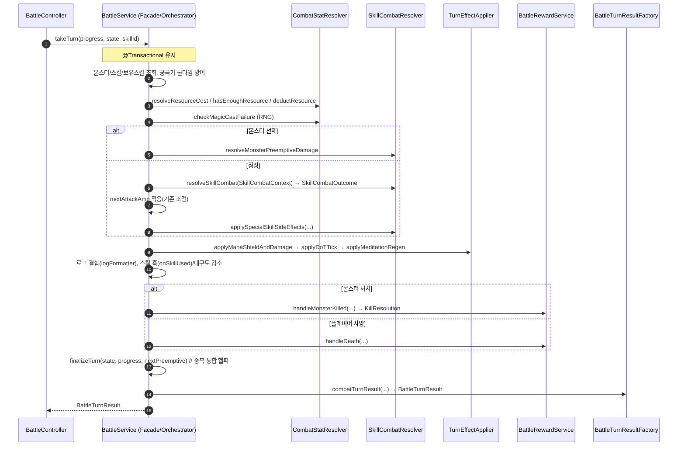
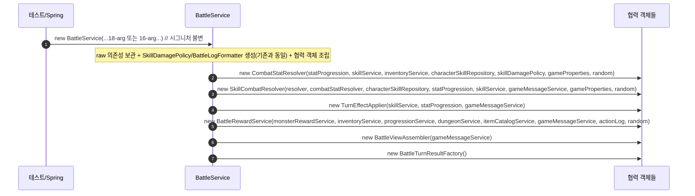

# Design Document: BattleService God Class 분해 (Battle Service Decomposition)

> **폴더 위치**: `.kiro/specs/myrpg/022-battle-service-decomposition/design.md`
> **관련 규칙**: `rules/coding/code-style.md`, `rules/workflow/codegraph-first.md`

---

## 1. Overview (개요)

본 설계는 `myrpg` 모듈(`com.myapps.web.myrpg`)의 God Class `BattleService`(약 1,752줄, 의존성 19개)를
**동작 보존(behavior-preserving) 리팩토링**으로 분해하기 위한 상세 설계를 정의한다. 기능 변경은 없으며,
전투 결과·로그 라우팅·예외·**RNG 소비 순서**·트랜잭션 경계는 리팩토링 전후 완전히 동일해야 한다.

분해 전략은 021(InventoryService 분해)에서 검증된 패턴을 따른다.

- **(A) 파사드 + 오케스트레이션/위임** — `BattleService`는 기존 public API와 두 생성자를 유지하고, 전투
  스탯/전투 처리/턴 효과/결산/뷰 조립을 관심사별 협력 객체로 이관한다. `takeTurn`/`flee`/타임아웃은 **얇은
  오케스트레이터**로 남아 협력 객체를 순서대로 호출한다(단계 순서·조건 100% 보존).
- **(B) 공유 헬퍼/팩토리로 중복 통합(DRY)** — 반복되던 스킬 조회·스탯 합산·몬스터 배율·`BattleTurnResult`
  빌드·턴 종료 확정을 단일 지점으로 모은다.

### 1.1. 핵심 설계 결정 및 트레이드오프

| 항목 / 대안 | 선택된 결정 | 근거 및 트레이드오프 | 관련 요구사항 |
|---|---|---|---|
| **분해 방식** | **파사드 + 협력 객체 추출(Extract Class)** | 021에서 검증됨. 파사드가 기존 계약 100% 보존 → 호출부/테스트 무변경. | Req 1, 2 |
| **협력 객체를 Spring 빈 vs 파사드 소유 plain 객체** | **파사드가 소유·구성하는 plain 객체** | 협력 객체를 빈으로 만들면 생성자에 주입해야 하고, 이는 **16-arg 하위호환 생성자로 직접 생성하는 20여 개 테스트**와 Spring 주입부를 모두 깨뜨림. plain 객체로 두면 두 생성자에서 raw 의존성으로 협력 객체를 조립할 수 있어 계약이 불변. (기존 `SkillDamagePolicy`/`BattleLogFormatter`를 `new`로 생성하던 패턴과 동일.) | Req 1.1, 1.2 |
| **오케스트레이션 위치** (파사드 유지 vs 별도 Orchestrator로 이전) | **`takeTurn`/`flee`/타임아웃 오케스트레이션은 파사드에 유지** | 오케스트레이션을 통째로 옮기면 God 메서드가 자리만 이동. 헬퍼 관심사를 협력 객체로 빼내 오케스트레이션이 "얇게" 읽히도록 하는 것이 목표이며 회귀 위험도 최소. | Req 2.4 |
| **트랜잭션 경계** | **`@Transactional`을 파사드 메서드에 유지** | 협력 객체가 빈이 아니므로 그 위 `@Transactional`은 프록시가 없어 무효. 파사드 진입점에서 트랜잭션이 시작되던 기존 동작을 그대로 보존. | Req 1.3 |
| **`CombatDispatchVisitor`(020) 이전** | **`SkillCombatResolver`의 내부 클래스로 이동** | 방문자가 호출하는 `resolve*Combat`이 전부 전투 처리 협력 객체로 이동하므로 방문자도 함께 이동해야 응집. 020의 Visitor/디스패치 동작은 그대로 보존. | Req 2.1, 4.1 |
| **협력 객체 간 결과 전달** | 내부 컨텍스트/결과 타입(`SkillCombatContext`/`SkillCombatOutcome`) 도입 | 방문자가 캡처하던 8개 필드를 컨텍스트로 묶어 전달. `TurnCombatResult`는 battle 패키지로 이동해 협력 객체·파사드가 공유. DTO 변경 아님(내부 전달용). | Req 2.1 |
| **RNG(`Random`) 주입** | 파사드가 보유한 **동일 `Random` 인스턴스를 협력 객체에 주입** | 마법 실패/CC/빙결/연쇄/선후공 등 RNG 소비가 여러 협력 객체로 흩어져도 **단일 시드 스트림을 공유**해야 소비 순서가 보존됨. `flee`의 도망 성공 롤은 파사드에 남으므로 파사드도 `random`을 계속 보유한다(§3.3). | Req 4.6 |
| **파사드 의존성 감소 폭** | **제한적임을 전제로 수용** | 021(인벤토리)은 순수 위임 파사드였으나, `BattleService`는 `takeTurn`/`flee`/타임아웃 오케스트레이션을 유지하므로 파사드가 raw 의존성 다수를 계속 보유한다(§3.3 목록). SRP 이득은 "관심사별 헬퍼 추출"에 있고, 파사드 의존성 **개수** 자체는 크게 줄지 않는다(대신 각 메서드의 복잡도·중복이 감소). | Req 2.4, 2.5 |

> **왜 plain 협력 객체인가 (가장 중요한 결정)**: 테스트 20여 개가 `new BattleService(battleStateRepo,
> resolver, monsterService, ... dungeonService)` 형태의 **16-arg 생성자**로 실제 인스턴스를 만든다. 협력
> 객체를 빈으로 바꾸면 이 테스트들과 Spring 주입부가 전부 바뀌어 "1%도 안 바뀜" 제약을 위반한다. 따라서
> 협력 객체는 파사드의 두 생성자 내부에서 raw 의존성으로 조립되는 plain 객체로 둔다.

---

## 2. Architecture (시스템 아키텍처 및 계층 구조)

### 2.1. DDD 4계층 내 변경 지점 (신규/수정)

```
myrpg/src/main/java/com/myapps/web/myrpg/
├── application/
│   └── service/
│       ├── BattleService.java                  # [수정] 파사드 + takeTurn/flee/타임아웃 오케스트레이션, 협력 객체 조립·위임
│       ├── battle/                             # [신규 패키지] 전투 협력 객체 모음
│       │   ├── CombatStatResolver.java         # [신규] 공격력/방어/크리/배율/블록/카운터/히트/자원 해석 + 캐스팅 실패
│       │   ├── SkillCombatResolver.java        # [신규] 스킬 타입별 전투 처리·선후공·디스패치(CombatDispatchVisitor 내부화)
│       │   ├── TurnEffectApplier.java          # [신규] 마나실드 흡수·피해 적용, DoT 틱, 명상 MP 재생
│       │   ├── BattleRewardService.java        # [신규] 처치 보상/던전(보스·카운트·연쇄)/사망 결산
│       │   ├── BattleViewAssembler.java        # [신규] 대치 페이즈 뷰·스탠스 뱃지·클래시 지속시간
│       │   ├── BattleTurnResultFactory.java    # [신규] BattleTurnResult 빌드 팩토리(19-인자 중복 제거)
│       │   ├── SkillCombatContext.java         # [신규] 전투 처리 입력 컨텍스트(record)
│       │   ├── SkillCombatOutcome.java         # [신규] 전투 처리 결과(TurnCombatResult + nextPreemptive)
│       │   └── TurnCombatResult.java           # [이동] 기존 BattleService 내부 record → battle 패키지 공개 record
│       ├── BattleResolver.java (domain/service)# [유지]
│       └── ...                                 # [유지] 협력 서비스들
└── domain/ ...                                 # [유지] 엔티티/DTO/enum 변경 없음
```

> **계층 규칙(ArchUnit)**: 모든 협력 객체는 `application/service/battle` 하위(=application 계층)에 위치하여
> `interfaces`(상위)를 참조하지 않는다. 참조 방향은 **파사드 → 협력 객체 → CombatStatResolver / 도메인
> 서비스(BattleResolver)** 단방향으로 유지하여 순환을 만들지 않는다.

### 2.2. `takeTurn` 오케스트레이션 시퀀스 (파사드 유지, 단계 순서 보존)



### 2.3. 생성자 조립 흐름 (계약 보존, 위상 순서)



> 협력 객체는 두 생성자 모두에서 동일하게 조립된다. 16-arg 하위호환 생성자는 기존처럼
> `GameMessageService`/`GameProperties`를 기본값으로 채운 뒤 동일 조립 경로를 탄다.
> **RNG 공유**: `CombatStatResolver`·`SkillCombatResolver`·`BattleRewardService`는 파사드가 보유한 **동일
> `Random` 인스턴스**를 주입받아 소비 순서를 보존한다(Req 4.6). `flee`는 파사드에 남아 이 `random`을 직접
> 소비하므로 파사드도 `random` 필드를 유지한다.
>
> **두 개의 RNG 스트림 구분(중요)**: `BattleService.random`(마법 실패·선후공·CC·빙결·연쇄 조우·도망 성공)과
> `BattleResolver` 내부 random(`resolver.rollCritical` 등 몬스터 크리 판정)은 **서로 다른 스트림**이다.
> 전자는 협력 객체에 공유 주입해 순서를 보존하고, 후자는 **단일 `resolver` 인스턴스**를 그대로 공유하므로
> 이미 보존된다. 구현 시 두 스트림을 혼동하거나 새 `Random`을 만들지 않는다.

---

## 3. Components and Interfaces (세부 컴포넌트 설계)

### 3.1. 책임 → 협력 객체 매핑표

**파사드는 각 helper를 대응 협력 객체 호출로 위임**한다(로직은 이동만, 내용 불변). `takeTurn`/`flee`/
`start`/`startClash`/`resumeIfActive`/타임아웃/도망 핸들러의 **오케스트레이션 골격은 파사드에 유지**한다.

| 협력 객체 | 이관되는 메서드 | 필요 협력자 |
|---|---|---|
| **CombatStatResolver** | `attackPower`, `resolvePrimaryStat`, `resolveCoefficient`, `resolveEquippedBonus`, `resolvePlayerDefense`, `resolvePlayerCritical`, `resolveEffectivePlayerCritical`, `resolvePlayerHitCount`, `resolvePlayerMultiplier`, `resolvePlayerBlockRate`, `resolvePlayerCounterPercent`, `resolveResourceCost`, `hasEnoughResource`, `deductResource`, `checkMagicCastFailure` | statProgression, skillService, inventoryService, characterSkillRepository, skillDamagePolicy, gameProperties, random |
| **SkillCombatResolver** | `resolveCombat`, `isBowFirstStrike`, `resolvePlayerPreemptive`, `resolveMonsterPreemptiveDamage`, `resolveNormalCombat`, `determineTurnOrder`, `resolveUltimateCombat`, `resolveRecoveryCombat`, `resolveBuffCombat`, `resolveCcCombat`, `resolveMonsterDamageForSupportTurn`, `resolveMonsterOnlyDamage`, `applySpecialSkillSideEffects`, **`CombatDispatchVisitor`(내부)** | resolver, combatStatResolver, characterSkillRepository, statProgression, skillService, gameMessageService, gameProperties, random |
| **TurnEffectApplier** | `applyManaShieldAndDamage`, `applyDoTTick`, `applyMeditationRegen` | skillService, statProgression, gameMessageService |
| **BattleRewardService** | `processKillReward`, `resolveItemName`, `handleMonsterKilled`, `handleDeath`, **`KillResolution`(공개 record)** | monsterRewardService, inventoryService, progressionService, dungeonService, itemCatalogService, gameMessageService, actionLog, random |
| **BattleViewAssembler** | `buildClashBattleView`, `resolveClashDuration`, `resolveStanceBadgeLabel`, `resolveStanceBadgeClass` | gameMessageService, (스킬 버튼은 파사드가 `combatSkills(progress)` 결과를 인자로 전달) |
| **BattleTurnResultFactory** | `buildNoOpResult`, `buildInsufficientResult`, 그리고 `takeTurn`/타임아웃/도망/`safeTerminate`의 `BattleTurnResult` 조립 | (무상태) |

> **파사드에 남는 것**: `start`, `startClash`, `takeTurn`, `flee`, `resumeIfActive`, `combatSkills`(위임),
> `swapWeapon`(위임), `handleTimeoutTurn`, `handleFleeSuccess`, `handleFleeFailure`, `safeTerminateAndReturn`
> (상태 저장부), `isUltimateOnCooldown`, 그리고 신규 `finalizeTurn` 헬퍼. 이들은 협력 객체를 호출·조율한다.
>
> **순환 방지**: `SkillCombatResolver`는 `CombatStatResolver`에만 의존(단방향). `BattleViewAssembler`는
> 스킬 버튼 목록을 스스로 조회하지 않고 **파사드가 `combatSkills(progress)`로 구해 인자로 전달**하여
> `inventoryService` 의존을 뷰 조립기에서 제거한다(기존 `buildClashBattleView` 내부 `combatSkills(progress)`
> 호출과 동일 결과).

### 3.2. `SkillCombatResolver` 계약 (전투 디스패치)

020의 `CombatDispatchVisitor`와 `resolve*Combat`을 이관하고, 파사드가 호출할 단일 진입점을 노출한다.

```java
/** 스킬 타입별 전투 처리·선후공·디스패치를 담당하는 협력 객체(CombatDispatchVisitor 내부화). */
public final class SkillCombatResolver {
    /** 정상 턴의 스킬 전투를 디스패치한다(기존 skill.accept(visitor) 경로 보존). */
    SkillCombatOutcome resolveSkillCombat(SkillCombatContext context);

    /** 몬스터 선제 피해(기존 resolveMonsterPreemptiveDamage). */
    int resolveMonsterPreemptiveDamage(CharacterProgress progress, Monster monster);

    /** 캐스팅 실패/타임아웃/도망 시 몬스터 단독 피해(기존 resolveMonsterOnlyDamage). */
    int resolveMonsterOnlyDamage(CharacterProgress progress, Monster monster, SkillType monsterAction);

    /** 특수 스킬 사이드이펙트(빙결/도트/분노 등). */
    void applySpecialSkillSideEffects(...);
}

/** 전투 처리 입력 컨텍스트(방문자가 캡처하던 8개 필드). */
public record SkillCombatContext(
        CharacterProgress progress, Monster monster, BattleState state,
        Optional<CharacterSkill> ownedSkillOpt, List<String> combatLines,
        SkillTalent equippedTalent, boolean isPlayerPreemptive, SkillType monsterAction) {}

/** 전투 처리 결과(턴 산출 + 다음 선제 파티). */
public record SkillCombatOutcome(TurnCombatResult combat, PreemptiveParty nextPreemptive) {}
```

- `TurnCombatResult`는 `battle` 패키지의 공개 record로 이동한다(필드 구성 불변). 파사드 `takeTurn`은
  `outcome.combat()`의 필드와 `outcome.nextPreemptive()`를 읽어 기존과 동일하게 진행한다.
- **동작 보존**: `CombatDispatchVisitor`의 `visitXxx`/`resolveDefaultCombat`/선후공 스킵/`nextPreemptive`
  설정 로직을 **그대로** 옮긴다. `combatLines`는 파사드가 만든 리스트를 컨텍스트로 넘겨 **동일 인스턴스에
  누적**한다(로그 순서 보존).
- **`applySpecialSkillSideEffects` 호출 순서(중요)**: 이 메서드는 `resolveSkillCombat` **내부가 아니라**
  파사드 `takeTurn`이 전투 결과 판독·`nextAttackAmp` 적용 **이후** 별도로 호출한다(원본 순서 그대로).
  즉 `resolveSkillCombat` → 결과 판독 → nextAttackAmp → `applySpecialSkillSideEffects` → `logFormatter`
  순서를 파사드가 유지하여 빙결/도트/분노 로그·상태 변경 시점을 보존한다.

### 3.3. 파사드(`BattleService`) 형태 및 중복 통합

```java
@Service
public class BattleService {
    // 오케스트레이션에 직접 필요한 협력자 + 신규 협력 객체 참조
    private final CombatStatResolver combatStatResolver;
    private final SkillCombatResolver skillCombatResolver;
    private final TurnEffectApplier turnEffectApplier;
    private final BattleRewardService battleRewardService;
    private final BattleViewAssembler battleViewAssembler;
    private final BattleTurnResultFactory turnResultFactory;
    // 오케스트레이션 직접 사용(계속 보유): battleStateRepository, monsterService, monsterAiService,
    //   skillCatalogService, characterSkillRepository, characterService, skillService,
    //   inventoryService, logFormatter, actionLog, gameMessageService, gameProperties,
    //   random(flee 도망 성공 롤)  ← 파사드가 오케스트레이터이므로 raw 의존성 다수를 계속 보유

    public BattleService(/* 18-arg: 기존과 동일 */) { /* raw 의존성으로 협력 객체 조립 */ }
    public BattleService(/* 16-arg: 기존 하위호환과 동일 */) { this(/* 기본값 채워 18-arg 위임 */); }

    @Transactional
    public BattleTurnResult takeTurn(...) { /* 얇은 오케스트레이션 */ }

    /** 턴 종료 상태 확정(중복 통합): takeTurn/타임아웃/도망 실패 3곳이 공유. */
    private void finalizeTurn(BattleState state, CharacterProgress progress, PreemptiveParty next) {
        state.setPreemptiveParty(next);
        state.setCurrentMonsterIntent(null);
        state.setStandby(true);
        state.setTurnCount(state.getTurnCount() + 1);
        battleStateRepository.save(state);
        characterService.saveTurn(progress);
    }
}
```

- **주의(동작 보존)**: `finalizeTurn`의 `next` 인자는 각 경로별로 기존과 동일해야 한다 — `takeTurn`은
  `nextPreemptive`(전투 결과), 타임아웃/도망 실패는 `PreemptiveParty.NONE`. 정산 라인→`actionLog` 반영은
  각 경로의 기존 위치를 유지한다(‐`finalizeTurn` 외부에서 처리하거나 별도 인자로 전달).

### 3.4. 중복 제거 상세 (Req 3)

| # | 중복 위치(현행) | 통합 방식 | 소속 |
|---|---|---|---|
| 1 | `findByCharacterIdAndSkillId(progress.getId(), skill.id())` 5곳 | `CombatStatResolver.findCharacterSkill(progress, skill) → Optional<CharacterSkill>` 단일 헬퍼 | CombatStatResolver |
| 2 | `levelStatsFor + resolveEquippedBonus + rankupBonus` 합산 3곳(공격력/방어/크리) | `CombatStatResolver.aggregatedStats(progress) → Stats` 헬퍼(레벨+장비+스킬 합) | CombatStatResolver |
| 3 | `monsterAction==HEAVY? heavyMult : normalMult` 2곳 | `SkillCombatResolver.monsterMultiplier(monsterAction)` 헬퍼 | SkillCombatResolver |
| 4 | 19-인자 `BattleTurnResult` 생성 7곳(takeTurn·타임아웃·도망성공·도망실패·안전종료·no-op·자원부족) | `BattleTurnResultFactory`의 의미별 팩토리 메서드(예: `combat(...)`, `monsterOnly(...)`, `terminal(outcome, lines)`, `noOp()`, `insufficient(skill, kind)`) | BattleTurnResultFactory |
| 5 | 턴 종료 확정 블록 3곳 | 파사드 `finalizeTurn(state, progress, next)` | BattleService |

> 각 통합은 **값 동치**여야 한다. 특히 #2 `aggregatedStats`는 기존 3개 메서드가 각각 뽑아 쓰던 필드(str/dex/
> int → attackPower, defense, critical)를 동일 합산식으로 계산하고, 호출부는 필요한 필드만 추출한다.
> #4 팩토리는 각 호출 지점의 기존 인자값(대부분 `false`/`null`/`List.of()` 기본)을 정확히 재현한다.

### 3.5. Presentation Layer / 호출부

- **변경 없음.** `BattleController`, `PlayScreenController`는 파사드의 7개 public 메서드를 그대로 호출한다.

### 3.6. Error Handling (예외 처리 설계)

| 예외 상황 | 처리 주체(이관 후) | 응답/폴백 | 관련 요구사항 |
|---|---|---|---|
| `startClash` 몬스터 미지 | BattleService(파사드) | 기존과 동일 `IllegalStateException("몬스터 정보를 찾을 수 없습니다.")` | Req 1.4 |
| `start`/`takeTurn`/`flee` 몬스터 미지 | BattleService(파사드) | 기존과 동일 `null`/`safeTerminateAndReturn` 폴백 | Req 4.5 |
| 미지 스킬 ID | BattleService(파사드) | 기존과 동일 `buildNoOpResult()` | Req 4.1 |
| 궁극기 쿨타임 잔존 | BattleService(파사드) | 기존과 동일 로그 + `buildNoOpResult()` | Req 4.1 |
| 자원 부족 | BattleService(파사드) | 기존과 동일 로그 + `buildInsufficientResult(...)` | Req 4.1 |
| 미보유 스킬 특수 처리 | SkillCombatResolver(Visitor) | 기존과 동일 폴백(`resolveDefaultCombat`) | Req 4.1 |

---

## 4. Data Models (데이터 모델)

- **신규 엔티티/DTO/JSON 카탈로그 없음.** `BattleState`/`BattleTurnResult`/`BattleView`/`TurnInput` 등 기존
  DTO·엔티티·JSON 스키마는 변경하지 않는다.
- **내부 전달 타입만 신규**: `SkillCombatContext`, `SkillCombatOutcome`, 그리고 이동되는 `TurnCombatResult`·
  `KillResolution`은 협력 객체 간 전달용 내부 타입이며 외부(컨트롤러/뷰/영속)로 노출되지 않는다.
- **불변성 유지**: 협력 객체 필드는 `final`, 신규 전달 타입은 `record`로 불변. 협력 객체는 turn-scoped
  가변 상태를 필드로 보유하지 않는다(입력은 컨텍스트/파라미터로 전달).

---

## 5. Correctness Properties (jqwik 검증용 불변 속성 명세)

### Property 1: 파사드 위임 동치성 (공개 계약 보존)
*For any* 유효한 입력에 대해, 리팩토링 후 `BattleService`의 각 public 메서드 결과(반환 DTO/부수효과/저장
호출/예외)는 리팩토링 이전과 동일해야 한다. (기존 회귀·PBT 테스트 무수정 통과로 검증)
- **Validates: Requirements 1.1, 1.4, 4.1~4.5, 4.7**

### Property 2: 턴 전투 결과 동작 보존
*For any* 유효한 전투 입력(캐릭터/몬스터/스킬/랭크/**시드 고정 `Random`**)에 대해, `takeTurn`의 데미지/크리/
블록/카운터/선후공/히트/자원/궁극기 쿨타임/특수효과 산출은 리팩토링 이전과 동일해야 한다.
- **Validates: Requirements 4.1, 4.2, 4.6** (기존 `BattleServiceCombatCharacterizationTest`,
  `BattleCombatPreservationPropertyTest`, `BattleServiceTurnOrderPropertyTest`,
  `BattleServiceEffectiveCriticalPropertyTest`, `BattleServiceUltimateTest`, `BattleServiceManaShieldTest`)

### Property 3: 결산/던전/사망 불변식
*For any* 처치/사망/던전(보스·일반·연쇄) 시나리오에 대해, 드랍·경험치·레벨업·던전 진행·연쇄 조우·사망
페널티 및 로그 라우팅은 리팩토링 이전과 동일해야 한다.
- **Validates: Requirements 4.3, 4.4** (기존 `BattleServiceChainCombatTest`, `BattleServiceDeathTest`,
  `BattleServiceLogSplitTest`, `BattleServiceLogRoutingPropertyTest`)

### Property 4: RNG 결정성 & 흐름 불변식
*For any* 시드 고정 `Random`과 도망/마법실패/타임아웃/선후공 시나리오에 대해, RNG 소비 순서·횟수와 결과가
리팩토링 이전과 동일해야 하며, 대치 뷰(뱃지/지속시간)도 동일해야 한다.
- **Validates: Requirements 4.5, 4.6** (기존 `BattleServiceFleePropertyTest`,
  `BattleServiceMagicCastFailurePropertyTest`, `BattleServiceClashTest`,
  `BattleServiceResourcePropertyTest`)

---

## 6. Testing Strategy & Quality Guardrails (테스트 및 품질 검증 전략)

### 6.1. 테스트 계층
1. **회귀/PBT 테스트(기존, 1차 안전망)**: `BattleService*Test`(≈20개) 및 §5의 모든 프로퍼티 테스트가
   **무수정 그린 유지**. 파사드 계약·RNG 결정성 보존의 핵심 검증 수단이다.
2. **Characterization 테스트(필요 시 선행)**: 기존 테스트로 커버되지 않는 분해 지점(예: `finalizeTurn` 3경로
   동치, `BattleTurnResultFactory` 각 팩토리의 필드값, 명상/DoT 경계, 던전 보스 판정 경계)이 발견되면 코드
   이동 **착수 전에** 현행 동작을 고정하는 테스트를 먼저 추가한다.
3. **협력 객체 단위 테스트(선택)**: 추출 후 각 협력 객체를 직접 단위 테스트하여 커버리지·응집도를 보강한다.
   단, 파사드 경유 기존 테스트가 이미 커버하는 경로는 중복 작성하지 않는다.

### 6.2. 테스트 작성 규칙 (`rules/coding/code-style.md`)
- Given-When-Then 3단계 주석, `should_{동작}_when_{조건}` 네이밍.
- Spring Boot 4.0: `@MockitoBean`, `@WebMvcTest`/`@DataJpaTest` 신규 패키지, Jackson 3 `tools.jackson`.
- jqwik + Mock: `Mockito.mock()` 직접 호출, `@Mock` 금지. **시드 고정 `Random`** 으로 RNG 결정성 검증.
- **리팩토링 안전망**: 각 협력 객체 추출 단계마다 전체 테스트가 그린인지 확인 후 다음 단계로 진행.

### 6.3. 5대 품질 가드레일 실행 명령어
```bash
mvn -B -q spotless:apply -pl myrpg && (mvn -B clean install -pl myrpg -am > /tmp/mvn.log 2>&1 || (tail -n 30 /tmp/mvn.log && exit 1)) && tail -n 12 /tmp/mvn.log && codegraph sync
```

> **PMD/CPD 기대 효과**: 본 리팩토링은 `BattleService`의 God Class 규모, `takeTurn`의
> `CognitiveComplexity`/`NcssCount`, 스킬 조회·스탯 합산·결과 빌드 중복(CPD)을 **감소**시켜야 한다. 각 협력
> 객체는 단일 책임으로 복잡도가 낮아야 하며, 가능하면 기존 클래스/메서드 수준 `@SuppressWarnings`
> (`PMD.CyclomaticComplexity`/`PMD.CognitiveComplexity`/`PMD.NcssCount`)를 제거/축소한다.
