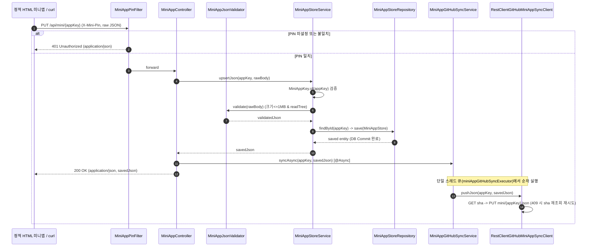

# Design Document: mini-app-store

> **폴더 위치**: `.kiro/specs/myshare/002-mini-app-store/design.md`
> **관련 규칙**: `rules/coding/code-style.md`, `rules/workflow/codegraph-first.md`

---

## 1. Overview (개요)

본 설계는 `myshare` Web 모듈(`com.myapps.web.myshare`, 포트 `8084`)에 정적 HTML 미니앱 공용 JSON 저장소 API(`/api/mini/{appKey}`)를 추가하고, Oracle Cloud DB(`MINI_APP_STORE`) 영속화, `X-Mini-Pin` 인증, `@Async` 기반 `gonyda/mike` `mini/{appKey}.json` 비동기 동기화를 구현하기 위한 아키텍처와 상세 명세를 정의한다.

### 1.1. 핵심 설계 결정 및 트레이드오프
| 항목 / 대안 | 선택된 결정 | 근거 및 트레이드오프 | 관련 요구사항 |
|---|---|---|---|
| **DB 연결 활성화** | `MyshareApplication`에서 DataSource/JPA 제외 해제 + `mycalendar`와 동일한 Oracle Wallet(`local`/`prod`)·H2(`test`) 설정 | 기존 `myapps` 멀티모듈 인프라(Parent POM `ojdbc11`, Wallet, `DB_PASSWORD`)를 그대로 재사용 | Req 1.1 |
| **PIN 인증 방식** | `OncePerRequestFilter`(`MiniAppPinFilter`, 빈 이름에 `security`/`authentication`/`authorization` 미포함) + `MessageDigest.isEqual` 상수 시간 비교 | Spring Security 미도입 원칙(`MyshareApplicationTest`) 준수, `/share/**` 비간섭, `@WebMvcTest` 자동 적용 | Req 3.1~3.4 |
| **JSON 검증 & 저장** | raw `String` 수신 → UTF-8 바이트 크기(1MB) 검사 → Jackson 3 `ObjectMapper`(`FAIL_ON_TRAILING_TOKENS`) `readTree()` 검증 후 원문 그대로 CLOB 저장 | 앱별 스키마 자유도 보장 및 유효 JSON 문법/크기 강제 | Req 2.3~2.6 |
| **예외 응답 포맷 분리** | `MiniAppExceptionHandler`(`@Order(HIGHEST_PRECEDENCE)`, `assignableTypes = MiniAppController.class`)는 JSON 반환, `ShareExceptionHandler`(`@Order(LOWEST_PRECEDENCE)`)는 HTML 유지 | `/api/mini/**` JSON API와 `/share/**` HTML 서빙 간 응답 Content-Type 충돌 방지 | Req 1.3, 2.5 |
| **GitHub 비동기 직렬화** | `@Async("miniAppGitHubSyncExecutor")` + 단일 스레드 `ThreadPoolTaskExecutor`(core=1, max=1) + `409 Conflict` 최대 2회 재시도 | `@Async` 비동기 논블로킹 응답과 `gonyda/mike` 브랜치 커밋 순서 직렬화·충돌 방지를 동시에 달성 | Req 4.1~4.5 |
| **계층 분리 (ArchUnit)** | `application` 계층은 `GitHubMiniAppSyncClient` 포트와 `MiniAppJsonValidator`만 의존하며 `infrastructure`를 import하지 않음 | `myshare`의 `ArchitectureRuleTest`(`application` → `infrastructure` 금지) 준수 | Non-Functional 1 |

---

## 2. Architecture (시스템 아키텍처 및 계층 구조)

### 2.1. DDD 4계층 패키지 구조
```
myshare/src/main/java/com/myapps/web/myshare/
├── MyshareApplication.java                                  # DataSource/JPA AutoConfiguration 활성화
├── domain/
│   ├── exception/
│   │   ├── InvalidMiniAppKeyException.java                  # [신규] appKey 형식/경로 오류 예외 (400)
│   │   └── InvalidMiniAppPayloadException.java              # [신규] JSON 문법/크기 오류 예외 (400)
│   ├── model/
│   │   ├── MiniAppKey.java                                  # [신규] ^[a-z0-9_-]{1,64}$ 값 객체
│   │   └── MiniAppStore.java                                # [신규] MINI_APP_STORE JPA 엔티티
│   └── repository/
│       └── MiniAppStoreRepository.java                      # [신규] JpaRepository<MiniAppStore, String>
├── application/
│   ├── exception/
│   │   └── GitHubMiniAppSyncException.java                  # [신규] GitHub 푸시 실패 예외
│   ├── port/
│   │   └── GitHubMiniAppSyncClient.java                     # [신규] GitHub JSON 푸시 포트 인터페이스
│   └── service/
│       ├── MiniAppJsonValidator.java                        # [신규] Jackson 3 readTree + 1MB 크기 검증
│       ├── MiniAppStoreService.java                         # [신규] 조회(미존재 시 "{}") 및 @Transactional upsert
│       └── MiniAppGitHubSyncService.java                    # [신규] @Async 백그라운드 GitHub 동기화(예외 삼킴)
├── infrastructure/
│   ├── config/
│   │   ├── MiniAppProperties.java                           # [신규] myshare.mini-app.* 프로퍼티 (toString PIN 마스킹)
│   │   └── MiniAppConfiguration.java                        # [신규] @EnableAsync, 단일 스레드 실행기, Validator 빈
│   └── github/
│       ├── GitHubMiniAppUpdateRequest.java                  # [신규] GitHub PUT 요청 DTO (@JsonInclude NON_NULL)
│       └── RestClientGitHubMiniAppSyncClient.java           # [신규] sha 조회 + Base64 PUT + 409 재시도 구현체
└── interfaces/
    └── api/
        ├── MiniAppPinFilter.java                            # [신규] /api/mini/** X-Mini-Pin 헤더 검증 필터
        ├── MiniAppController.java                           # [신규] GET/PUT /api/mini/{appKey}
        ├── MiniAppExceptionHandler.java                     # [신규] /api/mini/** 전용 JSON 에러 핸들러
        └── ShareExceptionHandler.java                       # [수정] @Order(LOWEST_PRECEDENCE) 추가
```

### 2.2. 요청 흐름 및 시퀀스 다이어그램


---

## 3. Components and Interfaces (세부 컴포넌트 설계)

### 3.1. Domain Layer (`domain/model`, `domain/exception`, `domain/repository`)
- **`MiniAppKey`**:
  - 허용 정규식: `^[a-z0-9_-]{1,64}$`.
  - null, blank, 대문자, 64자 초과, `.`, `/`, `\` 등 불허 문자 포함 시 `InvalidMiniAppKeyException` 발생.
- **`MiniAppStore`**:
  - `@Entity`, `@Table(name = "MINI_APP_STORE")`
  - `@Id @Column(name = "app_key", length = 64, nullable = false, updatable = false) private String appKey;`
  - `@Lob @Column(name = "data_json", nullable = false, columnDefinition = "CLOB") private String dataJson;`
  - `@Column(name = "updated_at", nullable = false) private LocalDateTime updatedAt;`
  - `@PrePersist` / `@PreUpdate`에서 `updatedAt`이 null일 경우 `LocalDateTime.now()`로 안전 보완, 서비스에서는 주입된 `Clock` 기준 `LocalDateTime.now(clock)` 전달.
- **`MiniAppStoreRepository`**:
  - `public interface MiniAppStoreRepository extends JpaRepository<MiniAppStore, String> {}`

### 3.2. Application Layer (`application/port`, `application/service`, `application/exception`)
- **`MiniAppJsonValidator`**:
  - 생성자: `(final int maxPayloadBytes, final ObjectMapper objectMapper)`
  - 내부적으로 `objectMapper.rebuild().enable(DeserializationFeature.FAIL_ON_TRAILING_TOKENS).build()` 사용(또는 Jackson 3 `ObjectMapper`의 `FAIL_ON_TRAILING_TOKENS` 적용)으로 `"{} extra"` 같은 후행 토큰까지 차단.
  - 검증 순서: `rawBody == null || rawBody.isBlank()` → UTF-8 byte length `> maxPayloadBytes` → `readTree(rawBody)` null 또는 `JacksonException` 발생 시 `InvalidMiniAppPayloadException`.
  - 성공 시 원문 `rawBody` 반환.
- **`MiniAppStoreService`**:
  - `@Transactional(readOnly = true)` 기본 + `upsertJson`에 `@Transactional`
  - `loadJson(final String rawAppKey)`: `MiniAppKey.of(rawAppKey)` 검증 후 `repository.findById(key.value()).map(MiniAppStore::getDataJson).orElse("{}")`.
  - `upsertJson(final String rawAppKey, final String rawJson)`: `MiniAppKey.of(rawAppKey)` 검증 → `jsonValidator.validate(rawJson)` → `findById` 조회 후 존재 시 `updateDataJson(validatedJson, now)`, 미존재 시 신규 생성 후 `repository.save(...)` → `validatedJson` 반환.
- **`GitHubMiniAppSyncClient`** (포트 인터페이스):
  - `boolean pushJson(String appKey, String jsonContent);`
- **`MiniAppGitHubSyncService`**:
  - `@Async("miniAppGitHubSyncExecutor")` on `public void syncAsync(final String appKey, final String jsonContent)`
  - `try { gitHubMiniAppSyncClient.pushJson(appKey, jsonContent); } catch (final Exception ex) { LOG.error(...); }`
  - 어떤 예외도 외부로 전파하지 않음.

### 3.3. Infrastructure Layer (`infrastructure/config`, `infrastructure/github`)
- **`MiniAppProperties`** (`@ConfigurationProperties(prefix = "myshare.mini-app")`):
  - `pin`: `${MINI_APP_PIN:}` (null → `""`)
  - `maxPayloadBytes`: `${MINI_APP_MAX_PAYLOAD_BYTES:1048576}` (`<= 0` → `1_048_576`)
  - `github`: nested record `GitHub(boolean enabled, String basePath, String commitMessagePrefix)`
    - 기본값: `enabled = true`, `basePath = "mini"`, `commitMessagePrefix = "chore(mini): sync"`
  - `toString()`에서 `pin`은 `pinConfigured=true/false`로 마스킹.
- **`MiniAppConfiguration`**:
  - `@Configuration`, `@EnableAsync`, `@EnableConfigurationProperties(MiniAppProperties.class)`
  - `miniAppGitHubSyncExecutor` 빈: `ThreadPoolTaskExecutor` (`corePoolSize = 1`, `maxPoolSize = 1`, `queueCapacity = 1000`, `threadNamePrefix = "github-miniapp-sync-"`, `waitForTasksToCompleteOnShutdown = true`, `awaitTerminationSeconds = 5`).
  - `miniAppJsonValidator` 빈 등록.
- **`RestClientGitHubMiniAppSyncClient`**:
  - 기존 `gitHubShareRestClient` 및 `GitHubShareProperties`(`owner`, `repo`, `branch`, `token`, `isActive()`) 재사용 + `MiniAppProperties.github()` 결합.
  - `!shareProperties.isActive() || !miniAppProperties.isGitHubSyncEnabled()` 시 HTTP 호출 없이 `false` 반환.
  - `GET /repos/{owner}/{repo}/contents/{basePath}/{appKey}.json?ref={branch}` → `sha` 추출 (404 시 empty).
  - `PUT /repos/{owner}/{repo}/contents/{basePath}/{appKey}.json` (`message`, Base64 `content`, `branch`, `sha`).
  - `HttpClientErrorException.Conflict` 발생 시 최신 `sha` 재조회 후 최대 2회 재시도, 실패 또는 기타 `RestClientException` 시 `GitHubMiniAppSyncException` 발생.

### 3.4. Interface Layer (`interfaces/api`)
- **`MiniAppPinFilter`** (`@Component`, `OncePerRequestFilter`):
  - `shouldNotFilter`: 요청 서블릿 경로가 `"/api/mini"`가 아니고 `"/api/mini/"`로 시작하지 않으면 `true` 반환 (즉 `/share/**`, `/health` 등 제외).
  - `X-Mini-Pin` 헤더와 `miniAppProperties.pin()`을 `MessageDigest.isEqual`로 비교(단, `configuredPin.isBlank()`이면 무조건 거절).
  - 실패 시 `401 Unauthorized`, `Content-Type: application/json;charset=UTF-8`, `Cache-Control: no-store`, `{"error":"Unauthorized"}` 응답 후 체인 중단.
- **`MiniAppController`** (`@RestController`, `@RequestMapping("/api/mini")`):
  - `GET /{appKey}` → `miniAppStoreService.loadJson(appKey)` → `200 OK`, `Content-Type: application/json`, `Cache-Control: no-store`, 보안 헤더(`X-Robots-Tag: noindex, nofollow`, `X-Content-Type-Options: nosniff`).
  - `PUT /{appKey}` (`@RequestBody(required = false) final String rawBody`) → `miniAppStoreService.upsertJson(appKey, rawBody)` → `miniAppGitHubSyncService.syncAsync(appKey, savedJson)` → `200 OK`, `Content-Type: application/json`, `Cache-Control: no-store`, 보안 헤더.
  - `@RequestMapping({"", "/", "/{appKey}/**"})` → `InvalidMiniAppKeyException` throw (`400 Bad Request`).
- **`MiniAppExceptionHandler`** (`@RestControllerAdvice(assignableTypes = MiniAppController.class)`, `@Order(Ordered.HIGHEST_PRECEDENCE)`):
  - `InvalidMiniAppKeyException`, `InvalidMiniAppPayloadException` → `400 Bad Request` (`{"error":"..."}`).
  - `Exception` → `500 Internal Server Error` (`{"error":"Internal Server Error"}`).

---

## 4. Data Models (데이터 모델 및 영속 스키마)

### 4.1. Oracle Cloud DB DDL
```sql
CREATE TABLE ADMIN.MINI_APP_STORE (
    app_key    VARCHAR2(64) PRIMARY KEY,
    data_json  CLOB NOT NULL,
    updated_at TIMESTAMP DEFAULT SYSTIMESTAMP NOT NULL
);
```

### 4.2. JPA 엔티티 (`MiniAppStore`)
```java
@Entity
@Table(name = "MINI_APP_STORE")
public class MiniAppStore {

    @Id
    @Column(name = "app_key", length = 64, nullable = false, updatable = false)
    private String appKey;

    @Lob
    @Column(name = "data_json", nullable = false, columnDefinition = "CLOB")
    private String dataJson;

    @Column(name = "updated_at", nullable = false)
    private LocalDateTime updatedAt;
}
```

---

## 5. Correctness Properties (jqwik 검증용 불변 속성 명세)

### Property 1: MiniAppKey 정규식 및 길이 불변식
*For any* `^[a-z0-9_-]{1,64}$`를 만족하는 문자열은 `MiniAppKey.of(s)`가 동일 값을 보존하여 반환하고, 대문자·공백·특수문자(`.`,`/` 등)·빈 문자열·65자 이상 문자열은 항상 `InvalidMiniAppKeyException`을 발생시켜야 한다.
- **Validates: Requirements 1.2, 1.3**

### Property 2: MiniAppJsonValidator 유효 JSON 보존 및 비정상 입력 차단 불변식
*For any* 유효한 JSON 객체/배열 문자열(크기 <= 제한)에 대해 `MiniAppJsonValidator.validate`는 입력 문자열을 손실 없이 반환해야 하며, 빈 문자열·크기 초과·깨진 JSON·후행 토큰 포함 문자열에 대해서는 항상 `InvalidMiniAppPayloadException`을 발생시켜야 한다.
- **Validates: Requirements 2.3, 2.4, 2.5**

---

## 6. Testing Strategy & Quality Guardrails (테스트 및 품질 검증 전략)

### 6.1. 테스트 계층
1. **jqwik Property Tests**: `MiniAppKeyPropertyTest`, `MiniAppJsonValidatorPropertyTest`.
2. **DataJpaTest**: `MiniAppStoreRepositoryTest` (H2 인메모리 DB 기반 insert / CLOB 저장 / update 검증).
3. **Unit Tests**: `MiniAppStoreServiceTest`, `MiniAppGitHubSyncServiceTest`, `RestClientGitHubMiniAppSyncClientTest` (`MockRestServiceServer` 활용 200/404/409 재시도/실패 검증), `MiniAppPropertiesTest`.
4. **WebMvcTest**: `MiniAppControllerTest` (`X-Mini-Pin` 401/통과, `GET` 200 `{}` 및 저장값, `PUT` 200/400, 잘못된 `appKey` 400, 기존 `/share/**` 비간섭 확인).
5. **SpringBootTest & ArchUnit**: `MyshareApplicationTest` (컨텍스트 로드 + Security 빈 부재 재검증), `ArchitectureRuleTest` 통과 확인.

### 6.2. 5대 품질 가드레일 실행 명령어
```bash
mvn -B -q spotless:apply -pl myshare && (mvn -B clean install -pl myshare -am > /tmp/mvn.log 2>&1 || (tail -n 30 /tmp/mvn.log && exit 1)) && tail -n 12 /tmp/mvn.log && codegraph sync
```
