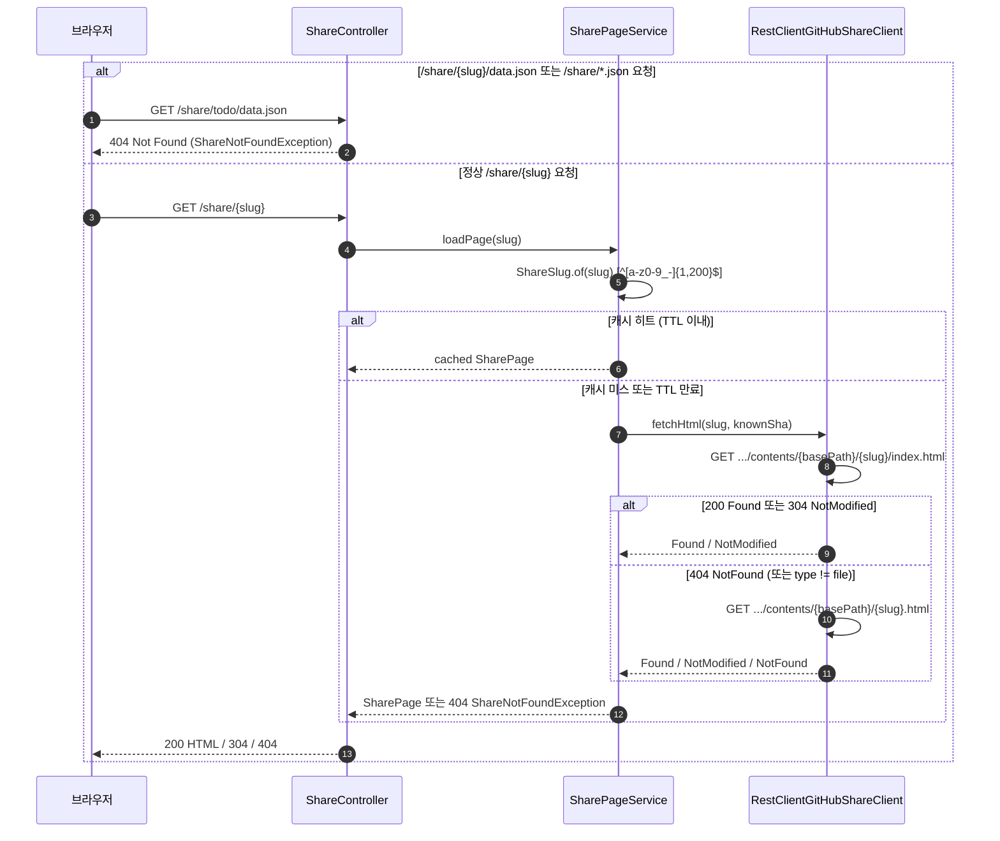
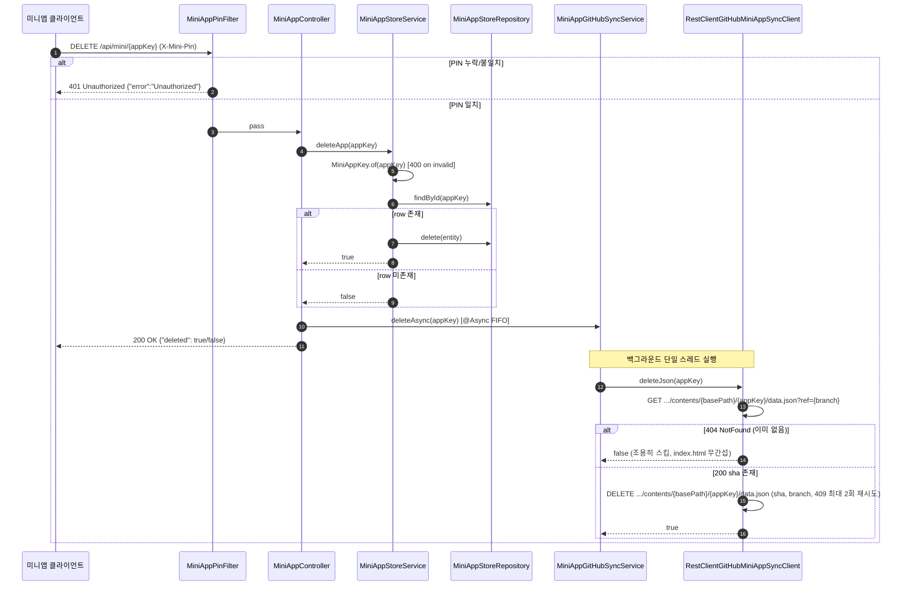

# Design Document: share-folder-unification-and-delete

> **폴더 위치**: `.kiro/specs/myshare/003-share-folder-unification-and-delete/design.md`  
> **관련 규칙**: `rules/coding/code-style.md`, `rules/workflow/codegraph-first.md`

---

## 1. Overview (개요)

본 설계는 `myshare` Web 모듈(`com.myapps.web.myshare`, 포트 `8084`)에서:
1. `gonyda/mike` GitHub 저장소 경로를 `share/{slug}/index.html` 및 `share/{slug}/data.json` 폴더 구조로 통일하고,
2. `GET /share/{slug}` 서빙 시 `index.html` 우선 조회 → 레거시 `{slug}.html` 폴백과 `/share/{slug}/data.json` 등 `.json` 직접 접근 `404` 차단을 보장하며,
3. `DELETE /api/mini/{appKey}` 멱등 삭제 API 및 `@Async` GitHub 단일 파일(`data.json`) 삭제 동기화를 구현하는 상세 아키텍처를 정의한다.

### 1.1. 핵심 설계 결정 및 트레이드오프
| 항목 / 대안 | 선택된 결정 | 근거 및 트레이드오프 | 관련 요구사항 |
|---|---|---|---|
| **HTML 폴더 우선 + 폴백 위치** | `RestClientGitHubShareClient.fetchHtml(slug, knownSha)` 내부에서 `{basePath}/{slug}/index.html` 우선 호출 후 `NotFound`일 때만 `{basePath}/{slug}.html` 폴백 | `SharePageService` 캐싱·ETag 재검증 흐름을 단순 유지하며, `index.html`이 304를 반환하면 1회 호출로 종료됨. `5xx` 등 장애는 폴백으로 숨기지 않고 즉시 전파함 | Req 2.3~2.6 |
| **`ShareSlug` 정규식** | `^[a-z0-9_-]{1,200}$`로 소문자·숫자·`_`·`-`만 허용 | 요청 스펙(`^[a-z0-9_-]+$`)에 맞추고 `MiniAppKey`와 문자 집합을 통일하여 대소문자 혼용으로 인한 폴더 불일치 방지. 기존 `MAX_LENGTH=200` 길이 상한은 유지 | Req 2.1, 2.2 |
| **`.json` 및 하위 경로 차단** | `@RequestMapping("/share/{slug}/**")`는 `ShareNotFoundException`(`404`) throw, 추가로 `*.json` 단일 세그먼트(`/share/{name}.json`)도 `404` 매핑 | `/share/{slug}/data.json`뿐 아니라 임의의 `/share/*.json` 웹 직접 접근까지 일관되게 `404 Not Found`로 차단해 파일 존재 여부 추측 방지 | Req 2.7 |
| **GitHub 동기화 기본 경로** | `MiniAppProperties` 기본값 및 `application.yml` 기본값을 `share`로 변경, URI는 `{basePath}/{appKey}/data.json` | `MYSHARE_GITHUB_BASE_PATH`와 동일한 `share` 루트 아래 `{appKey}/data.json`으로 통합. 환경변수 `MINI_APP_GITHUB_BASE_PATH`로 필요 시 오버라이드 가능 | Req 1.1~1.3 |
| **`DELETE /api/mini/{appKey}` 멱등성** | DB 존재 여부(`findById` → `delete`)에 따라 `{"deleted": true/false}` 반환, GitHub `deleteAsync`는 DB 결과와 무관하게 항상 트리거(404 시 조용히 스킵) | DB에는 없지만 GitHub에만 잔존하던 `data.json`도 멱등한 `DELETE` 재호출로 정리 가능하며, `index.html`은 경로 대상에서 완전 배제됨 | Req 3.3~3.8 |
| **GitHub `DELETE` 본문 전송** | `RestClient.method(HttpMethod.DELETE)` + `GitHubMiniAppDeleteRequest(message, sha, branch)` 사용 | GitHub Contents API `DELETE` 스펙이 JSON body(`message`, `sha`)를 필수로 요구하며, `RestClient.method(DELETE)`로 body를 안전하게 전송 가능 | Req 3.5, 3.7 |

---

## 2. Architecture (시스템 아키텍처 및 계층 구조)

### 2.1. 변경 대상 DDD 4계층 파일 구조
```
myshare/src/main/
├── resources/
│   └── application.yml                                            # [수정] MINI_APP_GITHUB_BASE_PATH 기본값 share
└── java/com/myapps/web/myshare/
    ├── domain/
    │   └── model/
    │       └── ShareSlug.java                                     # [수정] ^[a-z0-9_-]{1,200}$ 패턴 적용
    ├── application/
    │   ├── port/
    │   │   └── GitHubMiniAppSyncClient.java                       # [수정] deleteJson(String appKey) 추가
    │   └── service/
    │       ├── MiniAppStoreService.java                           # [수정] deleteApp(String rawAppKey) 멱등 삭제 추가
    │       └── MiniAppGitHubSyncService.java                      # [수정] @Async deleteAsync(String appKey) 추가
    ├── infrastructure/
    │   ├── config/
    │   │   └── MiniAppProperties.java                             # [수정] DEFAULT_GITHUB_BASE_PATH = "share"
    │   └── github/
    │       ├── GitHubMiniAppDeleteRequest.java                    # [신규] DELETE /contents 요청 DTO (message, sha, branch)
    │       ├── RestClientGitHubMiniAppSyncClient.java             # [수정] {basePath}/{appKey}/data.json 경로 + deleteJson 구현
    │       └── RestClientGitHubShareClient.java                   # [수정] {basePath}/{slug}/index.html 우선 조회 + {slug}.html 폴백
    └── interfaces/
        └── api/
            ├── ShareController.java                               # [수정] /share/{slug}/** 및 *.json 404 차단
            └── MiniAppController.java                             # [수정] DELETE /api/mini/{appKey} 추가
```

### 2.2. 요청 흐름 및 시퀀스 다이어그램

#### 2.2.1. `GET /share/{slug}` 우선 조회·폴백 및 `.json` 차단 흐름


#### 2.2.2. `DELETE /api/mini/{appKey}` 멱등 삭제 및 `@Async` GitHub 단일 파일 삭제 흐름


---

## 3. Components and Interfaces (세부 컴포넌트 설계)

### 3.1. Domain Layer (`domain/model`)
- **`ShareSlug.java`**:
  - 허용 정규식을 `^[a-z0-9_-]{1,200}$`로 변경한다.
  - `null` 또는 불일치 시 `InvalidShareSlugException`을 던진다.

### 3.2. Application Layer (`application/port`, `application/service`)
- **`GitHubMiniAppSyncClient.java`**:
  - 기존 `boolean pushJson(String appKey, String jsonContent)` 유지.
  - 추가: `boolean deleteJson(String appKey)` — 대상 `{basePath}/{appKey}/data.json`이 존재하면 삭제 커밋 후 `true`, 비활성화/토큰 미설정 또는 파일 미존재(404) 시 예외 없이 `false` 반환.
- **`MiniAppStoreService.java`**:
  - 추가: `@Transactional public boolean deleteApp(final String rawAppKey)`:
    - `MiniAppKey.of(rawAppKey)`로 형식 검증 (`InvalidMiniAppKeyException`).
    - `repository.findById(appKey.value())` 조회 후 존재하면 `repository.delete(...)` 실행 후 `true`, 없으면 `false` 반환.
- **`MiniAppGitHubSyncService.java`**:
  - 추가: `@Async("miniAppGitHubSyncExecutor") public void deleteAsync(final String appKey)`:
    - `gitHubMiniAppSyncClient.deleteJson(appKey)` 호출.
    - 성공 시 `LOG.info(...)`, 예외 발생 시 `LOG.error(...)`로 기록 후 예외를 삼켜 비동기 스레드 외 전파를 차단한다.

### 3.3. Infrastructure Layer (`infrastructure/config`, `infrastructure/github`)
- **`MiniAppProperties.java` & `application.yml`**:
  - `DEFAULT_GITHUB_BASE_PATH`를 `"mini"` → `"share"`로 변경.
  - `myshare/src/main/resources/application.yml`: `base-path: ${MINI_APP_GITHUB_BASE_PATH:share}`
  - `myshare/src/test/resources/application.yml`: `base-path: share`
- **`RestClientGitHubShareClient.java`**:
  - `fetchHtml(final String slug, final String knownSha)`:
    1. `fetchSinglePath(slug + "/index.html", knownSha)` 호출 (`.../contents/{basePath}/{slug}/index.html?ref={branch}`).
    2. 결과가 `ShareFetchResult.NotFound`이면 `fetchSinglePath(slug + ".html", knownSha)` 폴백 호출 (`.../contents/{basePath}/{slug}.html?ref={branch}`).
    3. `Found` 또는 `NotModified`이면 즉시 반환.
    4. `buildContentsUri(UriBuilder, String... fileSegments)` 헬퍼로 `basePath` 세그먼트 + 가변 파일 경로 세그먼트(`slug`, `"index.html"` 또는 `slug + ".html"`)를 조합한다.
- **`GitHubMiniAppDeleteRequest.java`** (신규):
  - `public record GitHubMiniAppDeleteRequest(String message, String sha, String branch) {}`
- **`RestClientGitHubMiniAppSyncClient.java`**:
  - 상수: `DATA_JSON_FILE = "data.json"`, `DELETE_COMMIT_PREFIX = "chore(mini): delete"`.
  - `buildContentsUri(UriBuilder, String appKey, boolean includeBranchRef)`:
    - `repos/{owner}/{repo}/contents/{basePath...}/{appKey}/data.json` 경로 생성.
  - `pushJson`:
    - 커밋 메시지: `miniAppProperties.github().commitMessagePrefix() + " " + appKey + "/data.json"`.
  - `deleteJson(final String appKey)`:
    - 비활성화(`!shareProperties.isActive() || !miniAppProperties.isGitHubSyncEnabled()`) 시 `false` 반환.
    - `appKey` null/blank 시 `GitHubMiniAppSyncException`.
    - `fetchCurrentSha(appKey)` 호출 → `Optional.empty()`(404)이면 조용히 `false` 반환.
    - `deleteWithConflictRetry(appKey, sha)`:
      - `restClient.method(HttpMethod.DELETE)`로 `GitHubMiniAppDeleteRequest` 전송.
      - `404 NotFound` 발생 시 이미 삭제된 것으로 판단해 `false` 반환.
      - `409 Conflict` 발생 시 `fetchCurrentSha(appKey)` 재조회 후 최대 `MAX_CONFLICT_RETRIES`(2회) 재시도(재조회 결과가 `empty`면 `false` 반환).
      - 재시도 소진 또는 기타 `RestClientException` 시 `GitHubMiniAppSyncException` throw.

### 3.4. Web Interface Layer (`interfaces/api`)
- **`ShareController.java`**:
  - `@RequestMapping("/share/{slug}/**")`: `ShareNotFoundException` throw → `404 Not Found` (기존 `InvalidShareSlugException` 400에서 변경; `/share/{slug}/data.json`, `/share/{slug}/index.html` 등 모든 중첩 경로 직접 접근 차단).
  - `@GetMapping("/share/{name:[^/]+\\.json}")` (또는 `@RequestMapping`으로 `*.json` 단일 세그먼트 요청 매핑): `ShareNotFoundException` throw → `404 Not Found` (`.json` 파일 직접 요청 시도 무조건 404 차단; 단 `/share/report.html` 등 비-JSON 잘못된 슬러그는 기존처럼 `ShareSlug` 검증에 의해 `400 Bad Request` 유지).
  - `@GetMapping("/share/{slug}")`: 기존 `getSharedHtml` 유지 (`ShareSlug`가 `^[a-z0-9_-]{1,200}$` 검증).
- **`MiniAppController.java`**:
  - `@DeleteMapping("/{appKey}")`:
    ```java
    @DeleteMapping("/{appKey}")
    public ResponseEntity<String> deleteAppData(@PathVariable final String appKey) {
        final boolean deleted = miniAppStoreService.deleteApp(appKey);
        miniAppGitHubSyncService.deleteAsync(appKey);
        return buildJsonResponse("{\"deleted\":" + deleted + "}");
    }
    ```
    - 응답 헤더: `Content-Type: application/json`, `Cache-Control: no-store`, `X-Robots-Tag: noindex, nofollow`, `X-Content-Type-Options: nosniff`, `Referrer-Policy: no-referrer`.

### 3.5. Error Handling (예외 처리 요약)
| 예외 / 상황 | 처리 주체 | HTTP 상태 & 응답 | 관련 요구사항 |
|---|---|---|---|
| `/share/{slug}/data.json` 등 `/share/{slug}/**` 또는 `/share/*.json` | `ShareController` → `ShareExceptionHandler` | `404 Not Found` HTML | Req 2.7 |
| `/share/{invalidSlug}` (대문자, `.html`, `..` 등) | `ShareSlug` → `ShareExceptionHandler` | `400 Bad Request` HTML | Req 2.1, 2.2 |
| `index.html` 및 `{slug}.html` 모두 미존재 | `SharePageService` → `ShareExceptionHandler` | `404 Not Found` HTML | Req 2.5 |
| `DELETE /api/mini/{appKey}` PIN 누락/불일치 | `MiniAppPinFilter` | `401 Unauthorized` JSON | Req 3.1 |
| `DELETE /api/mini/{appKey}` 잘못된 `appKey` | `MiniAppKey` → `MiniAppExceptionHandler` | `400 Bad Request` JSON | Req 3.2 |
| `DELETE /api/mini/{appKey}` 이미 없는 `appKey` | `MiniAppStoreService` | `200 OK` `{"deleted":false}` | Req 3.3 |
| GitHub `data.json` 삭제 시 404 미존재 | `RestClientGitHubMiniAppSyncClient` | 예외 없이 조용히 스킵 (`false`) | Req 3.6 |

---

## 4. Data Models (데이터 모델)

- **JPA 엔티티**: 기존 `MiniAppStore` (`ADMIN.MINI_APP_STORE`: `app_key`, `data_json`, `updated_at`) 변경 없음.
- **GitHub Contents 요청 DTO**:
  - `GitHubMiniAppUpdateRequest(String message, String content, String branch, String sha)` (기존 유지)
  - `GitHubMiniAppDeleteRequest(String message, String sha, String branch)` (신규 추가)

---

## 5. Correctness Properties (jqwik 검증용 불변 속성 명세)

### Property 1: `ShareSlug` 소문자 정규식 불변식
*For any* `^[a-z0-9_-]{1,200}$` 문자열에 대해 `ShareSlug.of`는 입력을 보존하며, 대문자·점(`.`)·슬래시(`/`)·공백·201자 이상 입력은 항상 `InvalidShareSlugException`을 던져야 한다.
- **Validates: Requirements 2.1, 2.2**

### Property 2: `DELETE /api/mini/{appKey}` 멱등성 불변식
*For any* 유효한 `MiniAppKey`에 대해 `deleteApp`을 연속 호출하면 첫 삭제 시에만 `true`(기존 존재 시), 이후 모든 호출에서는 상태 변경이나 예외 없이 항상 `false`를 반환해야 한다.
- **Validates: Requirements 3.3**

---

## 6. Testing Strategy & Quality Guardrails (테스트 및 품질 검증 전략)

### 6.1. 테스트 보강 항목
1. **`ShareSlugPropertyTest`**: `validSlugs`를 소문자(`a-z`, `0-9`, `-`, `_`)로 갱신하고, 대문자 포함 슬러그가 `InvalidShareSlugException`으로 거부됨을 검증.
2. **`RestClientGitHubShareClientTest`**:
   - `share/{slug}/index.html` 우선 조회 성공(200, 304) 시 `{slug}.html` 미호출 검증.
   - `share/{slug}/index.html` 404 → `share/{slug}.html` 폴백 성공 검증.
   - 둘 다 404 → `NotFound` 반환 검증.
   - `index.html` 5xx 오류 시 폴백 없이 `GitHubShareException` 전파 검증.
3. **`ShareControllerTest`**:
   - `/share/{slug}/data.json`, `/share/foo.json`, `/share/a/b`, `/share/{slug}/index.html` 요청 시 `404 Not Found` 차단 검증.
   - 대문자 슬러그(`/share/UpperCase`) 및 `.html`(`/share/report.html`) 요청 시 `400 Bad Request` 유지 검증.
4. **`MiniAppPropertiesTest` & `RestClientGitHubMiniAppSyncClientTest`**:
   - 기본 `basePath`가 `"share"`인지 검증.
   - `pushJson` URI가 `/contents/share/{appKey}/data.json`인지 검증.
   - `deleteJson` 테스트: 200 sha 조회 후 `DELETE` 성공(`true`), 404 미존재 시 `DELETE` 미호출 및 조용한 스킵(`false`), 409 Conflict 재시도, 비활성화/토큰 누락 시 스킵, 5xx 시 `GitHubMiniAppSyncException` 검증.
5. **`MiniAppStoreServiceTest` & `MiniAppGitHubSyncServiceTest`**:
   - `deleteApp` 존재 시 삭제 후 `true`, 미존재 시 `false`, 잘못된 키 `InvalidMiniAppKeyException` 검증.
   - `deleteAsync` 정상 호출 및 예외 삼킴 검증.
6. **`MiniAppControllerTest` & `MiniAppIntegrationTest`**:
   - `DELETE /api/mini/{appKey}`: PIN 누락/불일치 `401`, 잘못된 `appKey` `400`, 존재 시 `200 {"deleted":true}`, 재삭제/미존재 시 `200 {"deleted":false}` 멱등성 + `@Async deleteJson` 호출 + 예외 무영향 검증.

### 6.2. 5대 품질 가드레일 실행 명령어
```bash
mvn -B -q spotless:apply -pl myshare && (mvn -B clean install -pl myshare -am > /tmp/mvn.log 2>&1 || (tail -n 30 /tmp/mvn.log && exit 1)) && tail -n 12 /tmp/mvn.log && codegraph sync
```
